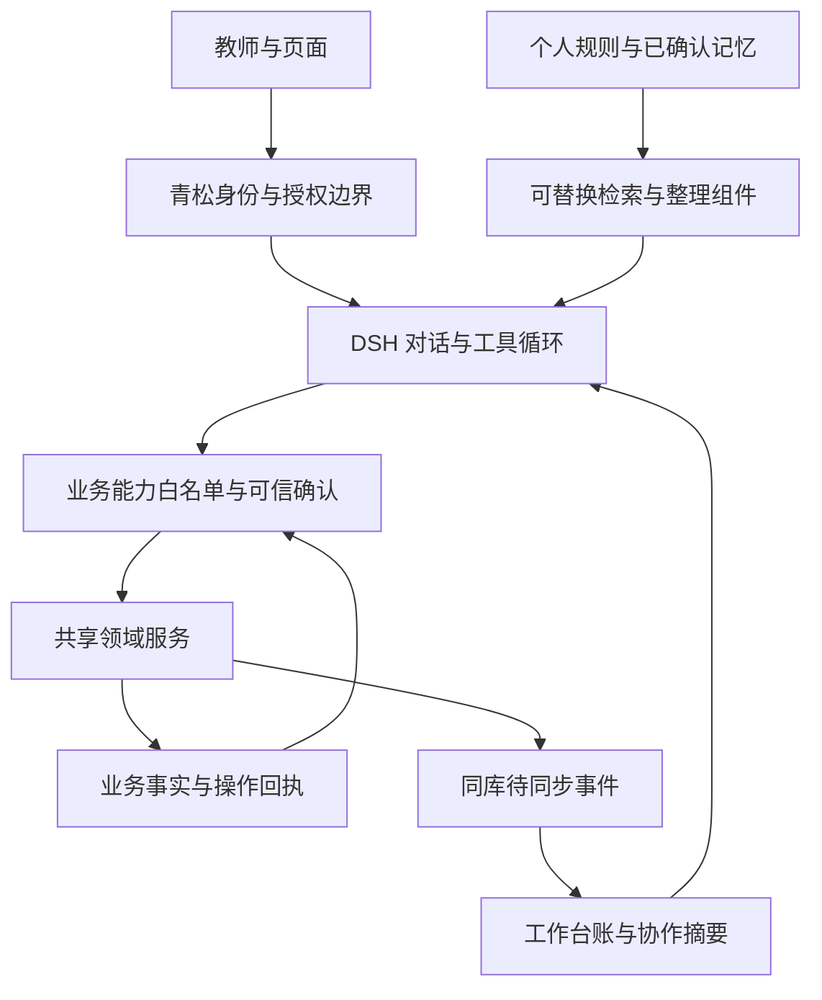

# 助手能力与记忆契约草案

版本：0.2 · 2026-10-28 · 状态：阶段 0 讨论稿，未实现。

## 本次概要与范围

依据用户确认的[阶段目标](ASSISTANT_EVOLUTION_PLAN.md)，将第一批业务动作、信息归属、工作状态和数据补强落实为可评审契约。本轮只写文档；下列名称、数据结构和状态是设计，不是已存在的工具或表。

原始问题：教师可以在系统中记录学生、任务和日程，但助手尚不能可靠地更新这些记录，也不能可靠地接续多日协作。目标：从一个课堂记录场景开始，形成有边界、可核验、可恢复的操作闭环。

已确认：学生主体手动维护；动态信息可受控更新；页面和助手共用领域服务；先原型后正式实现。假设：首个场景采用已有课堂任务的结果记录，不先开放任务创建、归档、名单变更或批改写入。未决：原型交互、模型支持的参数、长期记忆框架及量化预算。正式代码目前无需修改；最短路径是复用课堂服务，备选整体数据库重建成本高且没有必要。

## 1. 系统边界与信息归属

| 信息 | 权威保存位置（目标） | 写入者与使用约束 | 纠正和生命周期 |
| --- | --- | --- | --- |
| 学生主体、身份与班级归属 | 现有业务库 | 教师手动维护；助手只读允许字段 | 遵循正式业务记录规则，不因遗忘 Memory 而删除 |
| 标签、观察、表现、任务与提醒 | 所属业务库 | 页面和助手共用窄范围领域动作，受权限和版本检查约束 | 撤回/纠正以事件或业务历史表达，保留来源 |
| 工具说明、字段定义、流程方法 | 代码契约与 Skill | 开发维护；不能作为某次执行成功的证据 | 按版本发布，不从聊天中任意改写 |
| 显式个人规则 | 现有个人库 | 用户编辑；冲突时遵从权限边界和当前明确要求 | 版本化、停用、到期、删除 |
| 正在协作的事项 | 工作区内工作台账 | 宿主程序管理状态；模型提出内容，不自行标记业务成功 | 开放事项持续保留至解决或取消；旧预览不能作为永久凭据 |
| 一次重要协作的经过与原因 | 可追溯的协作事件与摘要 | 原始事件程序记录，摘要可由模型生成 | 引用原始证据；可修订摘要，不覆盖原始结果 |
| 跨事项复用的偏好、背景、经验 | 个人库中的确认记录 | 明确要求可保存；推断形成候选；检索索引可重建 | 更正、替代、到期与遗忘传播到召回索引 |

例子：“小林今天没交作业”是待核实的业务事件；“周五再核对小林这项作业”是工作事项，若要主动提醒还须成为正式日程；“汇报先说未完成事项”是个人规则；“上次选择先私下沟通，因为不想公开点名”是带来源的协作背景。不能只把这四句一起塞进长期记忆。

个人偏好跨业务工作区复用，不包含跨工作区学生事实。工作事项首版按可信 userId + workspaceId 隔离；聊天只是来源与入口，同一用户同一业务工作区的新聊天可以继续。其他教师默认不能读取，未来共享需独立权限设计。

图中为目标边界：后台同步尚未实现，Memory 组件不能绕过共享领域服务写业务数据。

## 2. 统一调用合同（设计）

读调用返回 `data / observedAt / sources / coverage / nextCursor`。coverage 明确对象、时间、排除项和是否完整；空数组只证明当前完整覆盖范围内无匹配项。结果不可访问或失败时不得返回假空数据。

写动作分为准备、执行、查回执三步。外部可以统一包装入口，但内部只分派白名单中的具体动作，不提供任意 PATCH、SQL、文件写入或任意服务调用。

| 阶段 | 必要内容 | 程序保证 |
| --- | --- | --- |
| 准备 | 动作名、明确对象引用、参数、预期版本 | 核对身份/权限与业务前置条件；生成逐项前后差异、冲突、到期时间和签名预览 |
| 确认 | 预览摘要、受影响对象、变更内容 | 将真实用户确认绑定到规范化参数哈希、对象版本、操作者和工作区；模型不能伪造确认事件 |
| 执行 | 宿主生成的 operationId、有效确认及预览 | 同编号同内容返回已提交结果，同编号不同内容拒绝；检查版本和权限；单个动作事务内全成或全败 |
| 查回执 | 原 operationId | 返回提交时的动作摘要、时间与事件引用；当前业务状态另行读取，不能将后来修改冒充原回执 |

userId/workspaceId 从可信登录上下文获取，不接受模型自填。缺失字段表示不修改；清空必须是动作明确允许的显式意图。人名和班级名先解析为真实 ID，同名、日期不明或结果含混时先补充，不选第一个匹配。

第一版准备后在聊天中展示可审阅确认。教师当前请求若已明确完整授权，宿主可以将该请求绑定至核对后的具体动作，避免机械重复确认；不得由模型仅凭一句“用户同意过”放行。参数、对象或实质结果变化时重新展示并确认。具体交互须原型评审。

### 2.1 第一批能力目录

以下名称是逻辑动作，最终工具名称在实现方案中确定。

| 能力 | 输入与前置条件 | 输出与失败恢复 | 现有基础 / 首版范围 |
| --- | --- | --- | --- |
| 查询班级与学生 | 可访问 classId；学生可按已确认信息定位 | ID、允许字段与覆盖范围；同名需选择 | teachingQueries 已开放部分字段；不开放身份修改 |
| 查询课堂任务 | classId、日期或 taskId，必要分页 | 任务状态、逐人结果、版本、事件引用 | 复用现有查询；结果 null 是未记录，不是未交或不合格 |
| 首次记录结果 | active 任务；明确 participantId、expectedVersion、result；未豁免且尚无结果 | 预览和提交回执；任一成员冲突则本次不提交 | 映射 initial；助手必须显式传 members，不使用默认“剩余全部正向”推断 |
| 复测结果 | 已有首次结果；显式发生时间、结果和成员版本 | 新事件及前后结果；原记录不改写 | 映射 retest；不能把补录原始事件混同复测 |
| 纠正结果 | 当前有效事件 targetEventId、版本、纠正结果及原因 | 纠正事件、原事件引用；存在后续依赖则拒绝并展示最新情况 | 映射 correct；不删除历史 |
| 撤回误记 | 当前有效 targetEventId、版本及原因 | 撤回事件与恢复后的状态 | 映射 retract；不承诺任意历史事件都可一键撤回 |
| 查询操作结果 | 原 operationId，仍具备访问权限 | 操作是否提交、原回执、当前状态查询入口 | 已有 queryClassroomOperation；需补原回执摘要与当前 detail 的明确区分 |

原子批次只覆盖同一任务的一组明确成员；跨任务按多个动作分别返回结果，不伪装全局事务。“全班除了两人都已交”需先核对本次任务参与者和教师明确范围，再展开为具体名单，不能把查询未返回的学生当作已交。

首版不暴露通用 OperationInput 中的 metadata、lifecycle、participation 或 exemption，仅开放上表允许的结果动作。学生参与某项课堂任务和学生实体是不同对象，但首版仍暂不增加参与者修改能力。

### 2.2 后续动作与前置补强

| 动作 | 合同要求 | 接入顺序 |
| --- | --- | --- |
| 添加/移除标签 | 只改该标签；保留其他档案字段；来源、版本、操作编号；推断标签先确认 | 阶段 2，先建设独立服务，禁止转调完整 updateStudent |
| 追加教师观察 | 学生引用、事实描述、发生时间与记录时间、来源；纠正追加关联事件 | 阶段 2；不将推断冒充教师观察 |
| 记录表现事件 | 现有领域语义、对象、发生时间、原因；复用可撤回机制 | 阶段 2；不自动推导人格或诊断 |
| 创建/调整/完成提醒 | 明确对象关联、时区、日期；调整需版本，重复事项明确单次或后续系列 | 阶段 2；完成与派生下一次发生需同一事务和幂等保证 |
| 检索资料与批改结果 | 权限、来源、引用、覆盖与任务状态 | 阶段 3；查询开放不自动开放批改写入 |

## 3. 工作事项与恢复合同

建议工作区保存 `assistant_work_items / assistant_work_events / assistant_commands`，业务库保存对应待同步事件；均为待设计的逻辑表，不要求单独新建一个数据库服务。

事项至少包含 owner、workspace、目标、对象引用、草稿方案、未决问题、最近证据时间、revision、来源聊天和下一步。事件记录谁在何时提出/确认/执行了什么；命令记录不可变动作参数、指纹、授权引用、operationId、状态和回执引用。长期记忆仅引用必要背景，不复制整份工具输出。

| 状态 | 进入依据 | 允许的下一步 |
| --- | --- | --- |
| draft | 新目标或方案形成 | 查证后等待补充/确认，或取消 |
| awaiting_input | 对象、日期或含义未确定 | 收到补充后重新准备；不能执行 |
| awaiting_confirmation | 已生成具体预览 | 确认后执行；修改方案后重新准备 |
| executing | 命令已持久化且发起调用 | 根据业务证据转完成、失败或结果未知 |
| result_unknown | 调用断线、超时或重启，无法判定提交 | 先查原 operationId；未查到不等于必定失败，不自动生成新编号 |
| done | 所需业务动作均有成功回执 | 展示结果；后续修改形成新动作 |
| failed | 明确未提交，或业务返回确定失败 | 保留原因和草稿；修正后重新准备 |
| cancelled | 用户取消尚未执行的事项 | 不再执行；已经提交的部分须另行撤回 |

同一事项可以有多个命令，每条独立状态；部分成功必须逐项展示，不能只写“失败”或“完成”。重启扫描 executing 项时先转入待核对，不盲目重放。新聊天续办时重新查询业务，展示变化和未决问题；旧预览签名只有五分钟且绑定进程密钥，不能跨重启复用。

“完成”表示教师请求范围内的动作有证据完成，不表示未来跟进已执行。创建提醒成功也不表示提醒已送达。

## 4. 数据适配与实施顺序

| 优先级 | 改动目标 | 复用与迁移边界 |
| --- | --- | --- |
| P0 | 助手白名单动作适配与可信确认；原操作回执摘要 | 复用 classroomTaskService；所有助手结果写入统一走显式 members 的预览路线，避免单人入口绕过预览 |
| P0 | 工作状态、命令记录和业务待同步事件 | 命令意图先持久化；领域事务内写结果及待同步事件；后台幂等归并，处理跨库非原子窗口 |
| P1 | 学生动态字段与提醒的窄命令、版本和历史 | 保留业务库，新增必要字段/表；不整体替换学生档案模型 |
| P1 | 课堂列表数据库筛选、分页与必要索引 | 当前列表会加载任务详情再筛选；先用样本与查询计划验证，不宣称已有性能故障 |
| P2 | JSON 存储的错误语义及渐进迁移 | 先区分缺文件/损坏，再按业务边界迁移 SQLite；在线恢复点、对账和回滚方案须另批 |
| P2 | 持久作业执行器 | 状态记录、租约、重启恢复与重试策略；通知投递作为独立后续能力 |

不采用跨库双写后“都应该成功”的隐式假设。某条业务提交后即使摘要同步失败，也保留成功回执并重试同步；工作事项丢失回执时依靠原 operationId 对账。已有历史数据不因接入助手而删除或回填为模型推断。

## 5. 首批验收场景

1. 教师明确给出一项任务与两名学生结果 → 查询真实对象 → 展示差异 → 确认 → 写入 → 回执 → 新聊天续办并读到最新状态。
2. 两名学生同名、任务有多轮或只返回一页 → 补充/翻页，不猜测；尚未记录的结果不能解释为没交作业。
3. 确认前其他页面已改记录 → 阻止覆盖，展示最新变化；修改后的动作重新准备。
4. 提交成功后响应丢失 → 原编号查回执，不产生第二条业务记录；同编号不同内容拒绝。
5. 提交中服务重启 → 核对原动作；未查到先保留未知状态，不报告“没有保存”或盲目重做。
6. 纠正/撤回后发生新事件 → 按依赖检查处理，不能撤掉后续真实记录。
7. 模型请求改学生姓名、增删学生或传其他工作区对象 → 白名单/权限拒绝，不能走通用服务绕过。
8. 业务成功但记忆索引故障 → 仍报告真实业务成功；稍后补齐摘要，不再次执行业务。

## 6. Memory 的比较验证设计

主候选 ReMe、对照 MemOS 的名称沿用调研结果，不新增未经复核的兼容性结论。评估前固定当前 DSH 版本、部署形态、身份隔离与删除协议；不允许候选组件直接写业务库。原个人库继续是已确认内容的权威来源，框架先作为可替换的派生检索/整理层验证。

建议冻结 24 个合成教师场景，六类各四例：跨会话续办、事实纠正/替代、旧记录与当前业务冲突、到期/遗忘、用户/工作区隔离、组件中断。业务动作由确定性回执判定；记忆相关性由预先标注的必要背景与禁止召回项判定。同一批输入比较现有基线与两个候选，记录原始证据、模型与配置版本。

建议硬门槛：越权、重复业务写入、虚报成功及应删除内容继续进入有效召回均为 0；其余质量门槛须结合样本审阅确定。24 例是启动集，不构成泛化准确率证明。记录端到端和记忆阶段 p50/p95、额外模型调用、输入输出量与实际成本；尚无真实测量，不先编造毫秒/费用预算，原型确认后制定测试预算再进行模型评估。

## 7. 原型 v2 的具体修改方案（已批准，已完成本地原型，待用户评审）

原始问题：现有原型只有规则和记忆列表，没有表达工作事项与长期偏好的区别，也没有展示可靠执行流程；设置图标不符合现有图标规范。

事实：现原型是纯内存演示；Movies 的 AgentWorkbench 按行为原则、偏好、主 Agent、Skills、Memory、压缩和运行参数披露。假设：教师更需要看到设置的实际作用与当前事项，而不是编辑底层配置文件。未决：信息分组与确认交互需要用户评审。

无需改正式代码。推荐继续使用独立静态原型，备选直接改正式设置会混入未验证设计与业务权限，代价更高。

准备修改范围仅 `docs/prototypes/assistant-settings/` 的 `main.js / style.css / index.html / README.md` 及重建的 `prototype.js / prototype.css`：

- 使用项目现有 Lucide 标准设置图标；仅展开会话侧栏左下角出现，收起后隐藏。
- 设置分为工作方式、记忆与事项、能力与运行、OCR与评分；来源、作用范围、当前是否可配置逐层展开，不伪造支持项。温度等参数按实际适配器支持披露，不能把 OCR 阈值当成模型参数。
- 记忆与事项区分当前协作、已确认背景、待确认建议；工作事项展示下一步、业务来源和结果，而非一组无差别短句。
- 会话演示覆盖查询→预览→确认→回执；另设跨会话继续、版本冲突与结果未知分支。设置与聊天正文保持职责清楚，聊天不常驻记忆宣传或设置提示。
- 所有保存和执行仅作用演示数据，明确标识模拟状态。手机单主区域、可返回详情，按钮至少44px、输入至少16px，短屏关键操作可滚动到达。

风险与取舍：分组过多可能增加寻找成本，因此运行细节放入展开层；演示操作容易被误认上线，预览条持续显示模拟标记。检查限定为构建、语法、资源可达与代码审查；不调用模型、不访问真实学生数据、不做网页验收，手机和实际交互由用户评审。

## 证据入口

- `server/services/classroom/classroomTaskService.ts`：预览五分钟、身份绑定、版本、操作幂等、结果与撤回。
- `src/domain/classroomTasks.ts`：OperationInput、成员版本与事件模型。
- `server/services/assistant/teachingQueries.ts`：当前白名单、覆盖与未开放能力。
- `server/repositories/rosterRepository.ts`：createDetails 与 updateStudent 的完整档案语义。
- `server/repositories/scheduleRepository.ts`：重复提醒保存与派生逻辑。
- `server/repositories/workspaceFileStore.ts`：读取异常转空数据与整文件写入。
- `/Users/cxc/Projects/Movies/frontend/src/features/admin/AgentWorkbench.tsx`：Harness 披露分组参考，不代表青松已支持同样配置。

## ADR-01：复用业务服务，分离工作台账与长期记忆

状态：基于已确认方向的细化决策草案，待具体实现方案确认。

背景：正式业务记录、协作进度与个人偏好的正确性要求不同；仅靠对话摘要无法证明业务提交，也无法安全恢复未知结果。

决策：保留 DSH 和 SQLite，通过共享领域服务开放白名单动作；程序维护工作状态与命令回执；长期记忆框架用于可替换的提取、召回和整理。业务结果与派生索引通过事务内待同步事件衔接。

放弃的方案：直接开放数据库难以维持授权和业务不变量；将全部信息交给第三方 Memory 会形成第二套业务真相；整体重建数据库延长首个闭环交付且无充分依据。

代价：需要少量工作台账、命令对账与同步机制，显式承担跨库最终一致性。收益：每次写入有独立证据，检索组件可替换，组件故障与业务提交解耦。若现有领域服务无法保持这些不变量，应先修领域服务，不在 Agent 层叠加猜测性兜底。

## 修改历史

- 0.1 / 2026-10-28：将阶段目标细化为信息归属、首批能力、状态与恢复、数据顺序、验收场景、Memory 比较方法及原型 v2 修改方案。未修改正式代码、原型或生产数据。

- 0.2 / 2026-10-28：用户明确同意原型范围；完成独立v0.2原型及发送/历史状态演示。未授权或修改正式实现；代码检查不代表原型已获用户验收。

## 追加评审：参数与 Skill 的控制归属 / 2026-10-28

用户已明确确认：生成参数归管理员管理，Skill统一维护，记录为后续开发要求。原型v0.5已移除个人参数调节，正式配置未修改。归属决策已确认；管理员页面、用途策略、参数支持矩阵和Skill管理的具体实现仍待方案批准，不代表已实现。

建议Temperature、Top p、频率惩罚、存在惩罚、最大输出Token和随机种子按用途统一配置，管理员维护默认值、上限和版本；教师通过个人指令与当次请求表达需求。最大输出Token与上下文窗口必须分清。参数只有在具体模型、适配器及实际调用链支持时才开放，不承诺随机种子可使输出完全复现。现DSH通用控制合同只有temperature、maxTokens、reasoningEffort、stop，不能为其他常见字段先做假开关。

现有模型管理入口以owner隔离，但模型配置为共享来源；正式设计须披露配置影响范围。不能因页面置于某个教师工作区就称其“只影响本校/本人”。用途策略可以先覆盖记录查询、批改分析和内容起草，不先给每位教师建一套模型配置。

Skill建议分层：系统核心流程统一维护、按版本发布，不允许个人修改授权与业务不变量；教学方法模板可统一提供并按教师权限启用、填写参数；个人习惯放个人指令。未来确有复用需求再允许受限个人Skill，按owner/user+workspace隔离，不安装任意插件、不获取新工具权限，冲突时系统权限与业务合同优先。Skill正文保持可复用，不夹带学生事实、个人记忆或凭据。

个人指令是个性化行为文档，不等于可修改系统SOUL、权限合同或工具注册。原型默认只读和复制，明确编辑后才出现输入面；正式旧条目到文档的保存、版本与迁移需另行方案。

### 已确认的后续开发目标 / 2026-10-28

1. 管理员生成参数：维护用途默认值、允许范围、版本与实际生效范围；个人设置不提供Temperature、Top p、频率/存在惩罚、最大输出Token及随机种子的直接调节。接入前逐模型核实支持情况，未支持的字段不做假控件。管理员配置保存/校验/回读、权限隔离、变更对新请求的影响均须纳入验收；具体开发和发布另行批准。
2. 统一Skill：系统/业务Skill统一维护、版本化并按权限加载，复用规范领域服务，不能绕过学生主体保护、预览、版本或幂等合同。教学模板可提供受限选项和参数，个人习惯留在个人指令。首批不开放任意个人Skill安装、代码执行或工具扩权；历史中“未来受限个人Skill”仅是备选，不属于已确认首版范围。验收需覆盖版本可追溯、权限、按需加载及与个人指令冲突时的处理。
3. 上述是产品归属与后续目标确认，不授权立即修改正式运行时、模型配置、Skill注册或生产数据。实施应依赖已确认的原子能力合同，并另交具体方案。

“助手能力”当前是只读说明：解释可查询范围、权限与尚未开放项，不控制任何配置，也不是Skill管理。是否保留独立导航尚未确认；建议收敛为会话设置内可展开的“能力与权限”，未来由真实能力目录驱动，避免手写说明与实际开放范围不一致。本轮未删除或移动该导航项。
