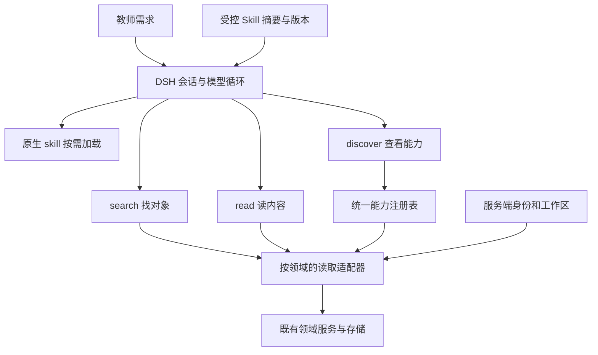

# 教学助手统一读取与 Skill 接入方案

版本：v0.4 · 2026-10-30（Asia/Shanghai）

状态：整体实现已随PR #105合并部署为b408920；本机及Linux自动检查完成，等待用户网页、手机与真实模型验收。

本次概要：根据用户纠正，将第一期调整为已有业务数据的统一查找与读取，包含资源、知识、批改及学生现有业务字段；不再把仅迁移旧查询当作第一期交付。内部按领域实现和检查，但不对每个领域重复索要批准。本文不修改现有教案方案或母文件夹的未跟踪内容。

## 1. 原始问题与目标

教师希望直接询问系统中的业务内容，无须理解数据库、页面或工具名称。当前助理只接入部分数据，业务后台已能读取的很多内容尚未开放给助理。

目标是让助理可靠完成“找到对象 → 读取必要内容 → 给出有依据的回答”，并根据任务按需加载统一维护的 Skill。工具按动作设计，业务规则按领域维护；新增字段通常扩展领域适配器，不新增模型工具。

首期仅做读取底座和 Skill 接入，不做业务写入、教案生成与编辑、持久任务执行器、主动通知、长期记忆框架替换或整体数据库迁移。个人规则和记忆沿用现有独立工具。

用户确认：学生当前业务字段按现有系统内容接入，不额外排除联系人、家庭等 schema 中可能存在的业务字段；以后新增限制由用户另行提出。这是读取范围决定，不是本轮已经检查真实数据或确认字段有值。身份、工作区隔离继续由服务端执行；凭据、认证配置、内部磁盘路径和运维日志不属于业务读取范围。

## 2. 已确认事实与尚未验证事项

### 2.1 实施前的覆盖基线

| 领域 | 助理已开放 | 后台已有而助理未完整开放 |
| --- | --- | --- |
| 班级、学生 | 班级列表、名单、性别、在籍、班委；日期内课堂记录与观察 | 现有学生业务字段：标签、知识强弱项、作业历史及 schema 中其他档案字段；本期统一接入 |
| 课表、提醒 | 课表、今日课程、提醒及日期筛选 | 节次配置等；不存在统一跨域发现合同 |
| 课堂 | 日期内任务与表现摘要、任务逐人结果和纠错事件 | 项目目录、关键词、生命周期、负向筛选、汇总和轮次上下文等 |
| 座位 | 已保存布局及学生对应关系 | 首期沿用现有读取 |
| 会话材料 | 当前附件及教师明确选中的材料池资料；list/read/render/stats | 整个材料池的自主搜索与读取不在现有授权合同内 |
| 资源与知识 | 未接入业务查询工具 | 资源目录、详情、文字块搜索、页内容、解析状态、知识树/节点/关系/来源、教学上下文检索 |
| 批改 | 未接入 | 任务、材料、题目分析、评分标准、试批、批量结果等；数据分布于 SQLite、JSON 和原文件，不是全部在 SQLite |
| 个人上下文 | 独立规则与记忆管理、召回 | 不等于业务工作状态或后台任务恢复 |
| 教案 | 静态预览 | 无可复用的已上线生成保存链路 |

### 2.2 DSH 已核实的机制

锁定依赖版本为 0.2.1-rc.3。本轮从已有 assistant-admin worktree 的 node_modules 只读核实同版本源码，未安装或修改依赖：

- `dsh-skill/lib/types/index.d.ts`：`ctx.skills` 提供摘要、正文、provider 合并与作用域查询；支持 `register`、`registerProvider`，并区分用户/模型可调用性。
- `dsh-tool-skill/lib/index.js`：原生工具名为 `skill`；先读取摘要再加载正文，发布摘要目录及目录变化；支持从真实用户消息识别 `/技能名`。
- `dsh-skill-filesystem/lib/index.js`：原生文件 provider 默认发现多类根目录，可配置来源；不能未经约束直接使用默认扫描范围。
- 青松 `agent/official-teaching.mjs` 的 guard 只放行 `qingsong_query`、`qingsong_material`、`qingsong_memory`，原生 `skill` 不在白名单。

结论：复用原生 Skill 目录和加载工具，补青松受控 provider 与 guard 接入；不另建一套自动分类服务，不再增加一次模型路由调用。由模型根据摘要选择 Skill，不承诺每次都能正确选择，须用场景评测。

尚未验证：运行中的原生 provider 组合、压缩后 Skill 保留行为、真实模型路由效果及长任务预算。依赖存在不代表这些行为已验收。

### 2.3 读取语义风险

`workspaceFileStore.ts` 的读取异常会返回空 Map/数组；学生 `profile_json` 解析异常也会回退默认字段。前者影响批改接入，后者影响扩展学生档案。接入相应领域前必须区分文件/对象缺失、内容损坏、权限拒绝与真正空结果，不将损坏解释成“没有记录”。

## 3. 推荐架构与备选取舍

青松拥有身份、权限、对象访问、字段定义、读取预算和结果合同；DSH 拥有对话、模型及工具循环。Skill 只说明方法，不增加工具权限。页面与助理复用相同领域服务，不经 HTTP 反调自己的业务路由。

备选一：每字段或每页面一个工具，维护与提示词成本高，放弃。备选二：让模型读表或执行 SQL，业务规则、权限与字段语义难以收敛，放弃。备选三：另做独立路由 Agent，增加调用、延迟及状态边界，现阶段没有必要。

## 4. 工具合同草案

模型侧新增三个固定动作工具，名称暂定 `qingsong_discover`、`qingsong_search`、`qingsong_read`。底层按领域注册，不把所有领域参数做成任意 JSON 透传。

| 动作 | 输入 | 输出 |
| --- | --- | --- |
| discover | 可选领域或对象类型 | 当前真实可用类型、筛选项、section、必填条件、限制及版本；仅列已实现且当前有权调用的能力 |
| search | type、query、该类型允许的 filters、page | 有界对象摘要、稳定引用、下一页、覆盖范围；不一次返回全部正文 |
| read | 上一步返回的 ref、受支持 section、offset/limit、可选 textOffset | 详情、关联记录、正文或来源页；保留完整性与出处 |

示例：search(type=resource, query=驿路梨花) → 返回 ref → read(ref, section=pages, range={start:5, limit:4})。学生、课堂任务、知识节点、批改任务沿用同一动作合同，由适配器检查参数及关系。

- ref 包含对象类型与不透明业务编号；不是授权票据。每次调用都从服务端当前身份重新检查工作区和对象权限，不接受模型提供的 userId/workspaceId、表名、磁盘路径或 SQL。
- 字段分成有限且有语义的 section，例如基本信息、观察、任务结果、页面；禁止任意字段路径。确实为空与尚未开放字段分别表达。
- 返回统一包含 requestId、observedAt、capabilityVersion、scope、completeness、分页和来源；失败返回稳定错误码、中文原因与下一步。正文限制按字符/字节及页数共同约束。
- 分页接口明确排序和变动边界，不把某一页称为全量统计；跨页数据变化时标注快照限制或要求重新查询。
- 日期、名称匹配、对象关联和字段投影由各类型 schema 校验。重名返回候选，不让模型自行猜编号。
- 不因 discover/search/read 的统一外壳而自动开放全部领域和字段。

材料权限维持原合同：search 不返回未选材料的正文，也不自动将材料池全库选入会话。read 可接续已有会话材料引用，内部复用材料读取器；render/stats 暂留现有材料工具。全材料池自主搜索是独立产品授权选择，本期不暗中开放。

## 5. Skill 接入

新增受控 provider，发布仓库中随版本维护的 Skill 摘要与正文。优先通过 `ctx.skills.registerProvider` 按需读取正文；不扫描教师上传目录、个人机器目录或任意安装包。

每个 Skill 记录 id、描述、版本、正文校验值、依赖能力与适用条件。加载前校验依赖是否真实可用，缺能力时明确返回缺项，不通过提示词假装支持。一次会话轮次绑定所用发布版本；更改版本后下一轮生效，活动轮不混用新旧规则。

首批仅提供系统内数据查找/读取方法 Skill，验证目录、按需加载及来源追踪。语文备课 Skill 等原文与认可基准补齐后另批接入，不写通用提示词冒充原教案 Skill。

guard 仅增加经过来源校验的原生 `skill` 及获批数据工具；禁止打开文件工具、Shell、插件安装或业务写入。Skill references 通过同一受控 provider 的资源合同解决，不为加载引用开放任意文件路径；首批可用自包含 Skill，禁止留下无法读取的引用。

## 6. 第一期内部实施顺序和准备修改的文件

以下 A/B/C 是同一交付范围的内部依赖顺序，不是三个独立待批产品阶段。代码实施前以当时最新 origin/main 复核；第一期整体获批后连续完成三部分、检查和交付，不就常规步骤反复询问。真正扩大范围时重新审批。所有代码用独立分支/worktree，不改母文件夹已有内容。

| 批次 | 文件及范围 | 完成条件 |
| --- | --- | --- |
| A：统一读取与 Skill 底座 | 新增 `src/domain/assistantCapabilities.ts`；新增 `server/services/assistant/capabilities/` 注册表、schema、dispatcher 及班级/学生已有字段、课堂、日程适配器；修改 `teachingQueries.ts` 复用共同目录/查询实现；修改 `officialAssistant.ts` 增加受控桥接；修改 `agent/official-teaching.mjs` 注册动作和 guard；新增 `agent/official-skills.mjs` 及 `agent/skills/system-data/`；修改 `official-runtime.mjs` 明确 provider 与插件组合 | 既有读取无退化；新入口能找后读；原生 Skill 可发现和加载、来源受限；能力描述由注册表生成 |
| B：资源与知识 | 新增 `server/services/resources/resourceRetrievalService.ts`；修改 `server/routes/resources.ts` 抽取既有只读检索逻辑；新增对应能力适配器；复用 `resourceRepository.ts`、`materialReader.ts`、`officialAttachments.ts` 必要的引用转换 | 找资源/知识 → 读片段 → 读来源页；已有页面接口行为保持；材料授权边界不扩张 |
| C：批改及学生业务字段 | 修改 `workspaceFileStore.ts` 和直接受影响的读取错误处理；新增批改能力适配器；按需修改 `gradingTasks.ts`、`gradingTaskManagement.ts` 保持页面可理解反馈；修改 `rosterRepository.ts` 的档案损坏语义及学生读取适配器 | 任务 → 题目/评分标准/试批或批量结果可查读；现有学生业务字段可按需读取；缺失、损坏、未确认、已确认状态清楚；不触发重新批改 |

配套测试位于各新模块同目录，以及 `agent/official-runtime.test.mjs`、`agent/integration.test.mjs`、`server/services/assistant/officialAssistant.test.ts` 等现有测试入口。专项状态更新只写本文；不同时重写多个旧方案。A 先迁移已有学生读取，C 补齐现有档案字段与损坏语义；两者都完成才算学生领域交付。每个领域以真实代码字段清单核对覆盖，不能用“已有数据都接通”代替逐项验收。

旧 `qingsong_query` 在新入口达到等价覆盖并通过迁移回归后撤销注册；旧会话的历史工具结果保留可读。迁移兼容仅做薄适配并明确删除时点，不长期保留两套领域逻辑。个人记忆工具保持独立；材料专有动作保留，不为形式统一强行重写。

## 7. 风险与验证

不直接放宽当前 8 步、12 次工具调用、180 秒上限。批次 A 记录 Skill 加载与分页的实际开销并明确定额归属；若最小读取场景无法完成，再提交有界预算变更。短查询、材料解析、未来教案应分别设预算，而非统一无限放宽。

最低自动验证集合：

1. 合成双教师隔离：伪造 ref、其他工作区对象、撤权后 read 均拒绝；discover 不泄漏不可见能力。
2. 班级重名/学生重名、任务班级不匹配、非法 section/filter、过大页数与日期范围均有明确结果。
3. 搜索命中后读取正文及来源页；分页边界、partial、真空结果和损坏错误可区分。
4. 材料未选择不可读，撤回/回收后不可继续读；解析不完整必须保留覆盖说明。
5. Skill 可发现、正文按需加载、依赖缺失、同名来源、版本切换和取消可追溯；恶意材料不能注册或替换 Skill。
6. 原生文字发送、附件、参数、SSE、取消、账号与业务 CSRF 既有合同不退化；HTTP helper 保持真实客户端格式。
7. 全部使用临时工作区、合成数据与假供应商；类型检查、构建及相关回归通过。真实模型/教师/手机由用户单独验收，不将离线通过写成实际路由效果已验证。

本方案不新增页面；如后续增加能力展示或交互，则另列 UI 范围及手机应用壳层验收。日志只记能力、耗时、数量、错误和版本，不输出学生正文或凭据。

## 8. 整体交付与审批边界

第一期目标整体包含 A/B/C：统一入口和 Skill 加载、班级与学生、课堂与日程座位、资源与知识、批改已有结果。仅迁移旧查询不能算本期完成。按依赖顺序先实现底座再逐域接入，最终按整个范围验收。

用户先确认整体方向及学生字段范围，随后回复“对的。继续”批准本版整体实施；另明确同意同步设置面板文案。推送、PR、部署与真实模型调用仍需另行授权。全材料池自主搜索仍沿用第4节的既有边界，不从学生字段决定推导材料权限扩大。

## 9. 本地实现与验证记录 / 2026-10-30

### 已实现

- 三个统一动作工具：`qingsong_discover/search/read`；11类对象为 class、student、classroomTask、behavior、project、schedule、reminder、resource、knowledge、grading、gradingMaterial。具体筛选与 section 以 `src/domain/assistantCapabilities.ts` 和服务端 schema 为准。
- 学生搜索覆盖现有在籍状态；按班级/学生引用读取现有档案及观察、作业、薄弱证据、课堂记录。搜索摘要不解析所有档案，单个损坏档案只阻止该档案详情读取，不阻断其他学生查找。
- 课堂任务逐人结果与事件、表现、项目、班级汇总、座位、课表、节次及提醒；资源标题/已解析正文搜索、文字块、页、原始 PDF 文字层、解析状态与建议；知识节点、关系、子节点、来源、修订及既有教学上下文检索。
- 批改任务、材料、解析块/页、题目分析、评分标准、试批、批量状态及当前流程版本的识别复核结果。保留 AI 与教师确认状态。诊断没有独立存档，返回明确错误而不假装已有诊断；不触发重新计算、OCR或批改。
- 原生 `skill` 已显式挂载；受控 provider 仅发布 system-data v1.0.0，记录正文SHA256并在加载时核实依赖能力。目录摘要常驻、正文按需加载；活动进程冻结正文版本。关闭默认文件/Office Skill 来源，未开放任意安装或执行权限。
- 原生路径已移除旧 qingsong_query 注册和旧 query 桥接。旧 SDK 读档所用 teachingQueries 模块继续隔离保留；其测试不作为新入口验收证据，未扩展旧运行时。
- JSON文件缺失、格式损坏、读取异常明确区分，损坏文件不自动覆盖；相关业务路由返回可理解的中文和 saved=false。学生档案解析损坏不再悄悄回退为空档案。
- 设置面板 `src/features/assistant/PersonalContextPanel.tsx` 按补充批准更新文案，能力名称从共享目录生成，无新布局、控件、请求或状态。

### 固定限制与实际边界

- 每轮仍为8步、共享12次工具调用、180秒。原生Skill工具加载计入调用数；依赖目录校验属于该次加载内部读取。
- 列表每页最多50项，日期跨度最多31天；原文读取每次最多10页，默认3页。单个长文本字段8000字符、整体正文50000字符保护；返回截断与 textWindow.nextTextOffset，可保持同一页并传 textOffset 续读长字段，总量不足时减小limit。
- 资源搜索的正文范围仅为已有解析且未排除的文字块，未解析文档不能视为全文搜索无命中。original读取PDF文字层；扫描件不自动OCR。材料池和其他会话附件授权不扩大。
- 知识与批改新增来源使用现有鉴权API URL，资源原件使用现有内容URL；未增加新的页面深链导航。
- 资源 jobs 沿用最近12条接口范围并标 partial；识别复核沿用业务服务的当前版本过滤。不存在“所有物理表、历史原始工件及日志均已开放”的承诺。

### 自动检查

使用 `/tmp/qingsong-node-v24.22.1-darwin-arm64/bin/node`，Office检查指定本机已有包含docx/pptx的Python运行时。依赖仅通过本worktree的忽略目录链接复用，未修改共享依赖、生产配置或真实业务数据。

- 领域/隔离/资料/流生命周期等14个测试文件51项通过，无跳过；包括统一入口5项场景、损坏与跨账号、原始PDF、长文本续读、批改材料与复核、旧查询及相邻领域回归。
- 原生运行时与Skill两个文件6项通过，含真实DSH schema编译、受控来源、依赖缺失、取消及版本信息。
- 完整HTTP/DSH三项通过：双教师真实登录会话、工具schema、查找→读取教材和批改、Skill加载、附件、记忆、反馈、管理员参数；另验证损坏存储HTTP503与原件不被覆盖。原生发送helper不添加真实客户端不存在的CSRF头。
- 类型检查、生产构建、差异空白检查通过；构建保留既有大chunk提示。

原始运行输出保留本机 `/tmp/qs-harness-domain.log`、`/tmp/qs-harness-agent.log`、`/tmp/qs-native-harness.log`、`/tmp/qs-capabilities.log`、`/tmp/qs-harness-build.log`。重跑命令为 Node24 `--import tsx --test` 对应测试文件；HTTP测试设独立 `QS_TEST_PORT=15475`，不占用已有预览端口。

全部调用均为合成数据和回环假供应商；真实模型/OCR调用0。未做浏览器、手机、真实材料与教师场景验收；尤其不能将假模型选择工具的通过，写成真实模型路由质量已验收。本段记录最初本地交付时的边界；随后已按用户明确授权推送、合并和部署，发布证据见下节。没有schema迁移、生产业务数据或备份改动。

## 10. 正式发布 / 2026-10-30

用户明确授权本次推送、PR、合并和部署，网页验收自行进行。应用PR #105已合并为 `b408920801d6347142889e2b9da66d97898752fa` 并从母文件夹main发布。服务器在与正式服务相同的用户/关键沙箱权限下重新安装锁文件依赖、构建并通过60项检查，无跳过。

9库完整性、外键、schema和表计数，以及8份业务JSON哈希前后一致；212份学生档案格式通过；既有1317文件/8库恢复点复验通过。服务active/running、NRestarts0，备份timer active；公网首页及8份JS/CSS哈希一致，匿名业务入口401。没有新增或删除恢复点、没有删除旧发布或改变模型/生产环境配置。

发布核对曾因Python元组与JSON数组直接比较而误报差异并自动回旧版；统一两侧表示后复验实际数据一致，再次切换完成，没有恢复数据库。详细证据与应用当前状态统一见 [PROJECT_HANDOFF.md](PROJECT_HANDOFF.md)，纯文档发布记录无需再次部署应用。真实模型和网页/手机仍由用户验收。

## 修改历史

- v0.1：首次记录统一读取方案、现有能力矩阵、DSH 源码核实、三批文件范围及验证合同。仅新增本文。
- v0.2：纠正过窄的分批交付，合并为已有业务数据读取的整体第一期；纳入学生现有业务字段，保留账号/工作区隔离及材料授权边界。仅更新本文，未修改代码。

- v0.3：按整体批准实现统一读取与原生Skill接入，补充批准后同步能力文案；记录测试、限制和待验收范围。

- v0.4：补记PR #105与正式部署、Linux60项检查、数据与公网静态核对及一次对账脚本误报后的自动回滚重发。
