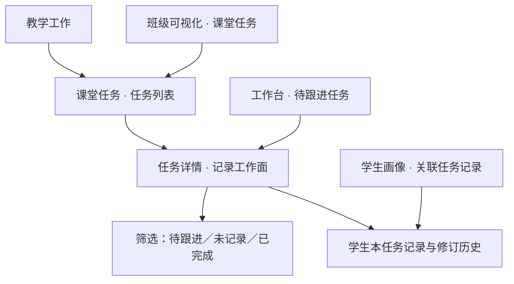

# 课堂任务产品设计

## 文档状态与授权

- 版本：v0.8；日期：2026-10-21；本轮实现见第21节，发布实况以 PROJECT_HANDOFF.md 为准。
- 状态：v0.8 经PR #65部署为ea04d2a，必要检查通过，待用户体验验收；证据见 PROJECT_HANDOFF.md。
- 当前阅读规则：第21节为本次边界，第18—20节为前版实现，第17节是产品方向；第1—16节保留历史依据与证据。后续版本替代的入口不再作为开发要求；数据准确性、权限隔离、历史及恢复约束继续适用。
- v0.4 授权：用户明确要求教师不必创建任务，应由系统自动处理；在收到仅更新本文的范围、取舍与验证方案后回复“同意”。本次仅修改本文，不包含原型、代码、配置、数据库、远端 Git 或部署。
- v0.3 授权：用户针对第14节明确回复“同意啊。先git，再worktree做，然后验收，然后pr什么的”。本轮执行本地实现、验收、提交、推送和PR；合并与部署仍需单独授权。
- v0.2 授权：用户针对项目盘点及推荐顺序回复“OK啊同意”。本轮落实为设计走查与实施方案文档更新，仅修改本文；不将顺序同意视为尚未提交的具体代码、数据、原型或部署方案批准。
- 用户已确认：入口放在“教学工作”下，名称为“课堂任务”；班级可视化提供带班级的快捷入口，多个入口使用同一份记录。用户随后授权“同意，你设计一下”。
- v0.1 文件范围：仅新增 `/Users/cxc/Projects/qingsong/docs/CLASSROOM_TASKS_DESIGN.md`。本方案不授权代码、配置、数据库、原型、远端 Git 或部署变更。
- 本次概要：保存状态并入信息条，轮次和新一轮入口外显，批量范围移入预览弹窗，待跟进和历史展示已有轮次，任务判定及首笔建立规则保持一致。
- 依据：用户决定、[竞品学习方案 v0.3](./TEACHER_WORKBENCH_COMPETITIVE_LEARNING_PLAN.md)、[自适应产品设计规范](./design.md)及本地代码核查。采用信息架构与响应式产品设计技能的方法，将导航、对象关系和验收统一在本文，避免拆成多份重复维护的文档。
- v0.1 代码基线：2026-10-20 本地 `main` 与只读查询的 GitHub `main` 均为 `fddf8ef8f8a3cde217674965f14bb7ced4eba2ab`；开发前重新同步。母文件夹中已有其他未跟踪文档和 `var-local-dev-2026-09-12/`，本轮不修改或清理。

| 版本 | 日期 | 修改概要 |
| --- | --- | --- |
| v0.8 | 2026-10-21 | 内联保存状态、显式新轮次、批量弹窗范围选择、列表日期与轮次 |
| v0.7 | 2026-10-21 | 连续点名、共享保存队列与名册、页面滚动、简化表单、历史直接归档／恢复 |
| v0.6 | 2026-10-21 | 可复用学业／表现项目、紧凑名单及画像名称联动；见第19节 |
| v0.5 | 2026-10-20 | 自动建轮、表现快记、画像联动及观察持久化；实现证据见第18节 |
| v0.4 | 2026-10-20 | 文档修订：日常记录免创建，首笔自动建立、按检查身份续接；明确状态、交互与待验证边界，未实施 |
| v0.3 | 2026-10-20 | 记录获批实现、78项回归、本地40人闭环、丢响应恢复及尺寸验收；待真实教师验证 |
| v0.2 | 2026-10-20 | 补充书面场景核算、代码依据和待批实施方案，纠正画像实际入口 |
| v0.1 | 2026-10-20 | 建立导航、核心页面、任务状态、补测与纠错、响应式行为、数据关系、候选实施范围和验收契约 |

## 1. 原始问题、目标与边界

教师检查一次背诵、订正、作业收交时，处理的是全班同一件事。现有教室支持单人观察，但逐个打开学生资料卡不适合连续记录；记录后还要找到未完成者，并知道后来是否补做或补测通过。

目标：教师为同一个班建立一次具体任务，快速记录全班结果，从相同记录得到可行动名单，后续补做、补测与纠错均能回到原任务。少重复输入，同时保留教师对事实、范围和修改的控制。

主要矛盾：课堂需要快速操作，课后需要准确区分“尚未核对、明确未完成、后来完成”和“当时记错”。先解决这一闭环，再扩展跨任务趋势或表现积分。

### 事实、假设与设计决定

| 类别 | 内容 |
| --- | --- |
| 已确认事实 | 当前导航已有教学工作、班级可视化、学生管理、工作台；已有稳定班级／学生 ID、学籍关系、座位和观察记录 |
| 参考观察 | WorkBuddy 有按班级／项目／日期快记、全班完成、撤销、本轮记录、名单下钻和补测入口；历史累计完成率和覆盖原结果存在语义风险 |
| 工作假设 | 收交／订正检查适合“完成情况”，背诵／技能检查适合“过关情况”；真实频率、教师耗时与常用叫法仍待验证 |
| 已确认导航决定 | 教学工作 → 课堂任务；教室和首页使用相同来源，不产生副本 |
| 本文设计建议 | 第一组先做完成／过关两种记录，明确任务身份、补做补测、撤销和保存；等第与表现积分后续按证据扩展 |

课堂任务是教师日常记录功能，不依赖 AI，也不限于语文学科；语文教案迁移仍独立遵守 [初中语文方案](./LESSON_PLAN_MIGRATION_PLAN.md)，其教学规则不注入本功能。

本组不承担外部考试成绩导入、考勤、值日、家校沟通、长期行为积分、学生端提交或 AI 自动判定。不改现有课表，不重建班级、学生和排座系统。

## 2. 信息架构与入口

以“一次具体任务”为组织中心。教师先找到要检查的那件事，随后在同一任务内记录、跟进和回看。



### 导航与返回

- “教学工作”顺序建议：AI 教案、课堂任务、AI 批改、学情诊断。只增加一个二级入口，不新增顶层大项。
- 任务列表是唯一管理入口。详情不另设“快记系统”“补测系统”和“汇总系统”；结果计数和筛选直接在详情中工作。
- 班级可视化工具区增加“课堂任务”。进入列表时带入当前班；有进行中任务时展示最近任务供选择，不凭名称／日期猜测应该打开哪次任务。
- 首页只呈现有明确待跟进记录的任务摘要，带班级、任务名、人数和截止信息；未记录人数另标，不合并成未完成。无截止时间不制造逾期。
- 学生页显示与该学生有关的任务、首次结果、当前结果及时间，可进入本任务历史；不自动把一次未通过变成长期“风险”标签。
- 返回时恢复来源页面、班级、筛选和滚动。页面导航沿用现有 `PageId`／`handleNavigate` 体系；首版不为此单独引入路由框架。刷新能恢复任务身份的具体方式在代码方案中确定。
- 外部入口带来的班级是导航参数，任务持有的班级才是记录范围。打开中的任务不可因全局班级改变而静默换班。

## 3. 第一组的最小完整范围

| 必须完成 | 预期行为 |
| --- | --- |
| 建立任务 | 班级、名称、检查日期、记录方式；可选截止日期和简短说明 |
| 两种记录方式 | 完成情况：已完成／未完成；过关情况：已通过／未通过 |
| 记录与批量操作 | 按学号排序的全班名单、明确的批量范围、批量预览、撤销上一操作和本轮记录 |
| 同任务跟进 | 筛选明确未完成／未通过的学生，追加补做／补测结果 |
| 原记录回看 | 区分事实后续变化与录入纠错，保留来源、时间及修订链 |
| 保存恢复 | 已保存、保存中、失败、结果待核对可辨；重试不产生重复事件 |
| 入口衔接 | 教学工作正式入口、班级可视化带班入口、首页轻量摘要、学生记录回看 |

等第 A/B/C/D 不直接等同过关，需先确定评价口径；表现加减分是可以反复发生的事件，不能硬塞成一人一个完成状态。因此二者保留扩展方向，不作为首个闭环的必做项。首组不做自动重复任务，提供“再建一次”即可。

## 4. 页面一：任务列表

页头“课堂任务”，主要操作“新建任务”。当前班级可见，支持全班级查看；每张任务卡始终带班级，跨班不靠颜色辨认。

局部筛选使用“进行中／已结束／已归档”，默认进行中。班级、日期范围和搜索按需展开；“只看有待跟进”是筛选条件，不与任务生命周期混成一组状态。

任务卡优先信息：名称、班级、检查日期、记录方式、当前结果摘要、截止状态。整卡进入详情；“再建一次／结束／归档”等放在明确的更多菜单。进行中按有截止且逾期、近期截止、最近操作排序；排序规则对无截止任务不能伪造日期。

示例（演示设计数据，不是实测）：

```text
课堂任务                       ［新建任务］
七年级3班 ▾    进行中 · 3项

《陋室铭》背诵检查              过关情况
10月20日 · 七年级3班
已通过32 ｜未通过6 ｜未记录2
待跟进6人 · 明天截止            ［进入记录］

阅读练习订正                    完成情况
10月20日 · 七年级3班
已完成35 ｜未完成3 ｜未记录2
待跟进3人                      ［进入记录］
```

空状态：没有班级时进入已有建班入口；有班级无学生时进入名册导入；有学生无任务时提供新建。读取失败显示原因和重试，不能伪装为“暂无任务”。

## 5. 建立任务：输入一次，共享上下文

必填为班级、名称、检查日期、记录方式。日期默认今天（教师本地教学日期），可修改；已有当前班级时预填。可选截止日期和说明，不要求先建模板或填写复杂教学目标。

新建后生成稳定任务 ID，即使同班同日同名也不是同一个任务。系统提示可能重复的既有任务，教师可进入旧任务或明确“另建一次”，不能自动覆盖或合并。

创建时固定该次任务的参与名册：班级内有效学籍、稳定学生 ID，以及当时学号／姓名显示快照。教师可显式增减参与者，排除原因可选但应可追溯；不随当前名册悄悄改变历史分母。

“再建一次”复用任务名称、记录方式和说明，重新选择日期并取得新名册；不复制任何学生结果或补测事件。首版以此支持每天或每周重复检查。

已有记录后不能直接改班级或记录方式。日期／名称可以修正但保留修订历史和影响提示；已结束任务修改前须明确重新打开。换班应新建正确班级的任务并处理误记录，不能按同名学生迁移成绩。

## 6. 页面二：同一个任务的记录工作面

顶部稳定显示返回、任务名、班级、检查日期和保存状态。其下是结果计数与筛选；“名单／座位”是同一记录面的展示切换，默认名单。

首组以名单完成闭环；座位视图在复用现有座位画布而不复制排座逻辑的前提下接入。若需大范围重构，则先保留教室入口带入名单，不为它扩大首组实现。没有座位的学生始终在独立可见的“未落座学生”区域，不能漏记。

### 6.1 手机布局示意

```text
〈课堂任务    《陋室铭》背诵检查    ⋯
七年级3班 · 10月20日             已保存
通过32   未过6   未记录2          本轮记录
全部 ｜待跟进6 ｜未记录2 ｜已通过32
［搜姓名／学号］                 ［批量］

01 张同学      未记录     ［通过］［未过］
02 李同学      未通过     ［补测］［更多］
03 王同学      已通过     ［改正］
…

固定反馈区：已保存 李同学·未通过    ［撤销］
```

名单行同时显示学号、姓名、文字状态和操作。过关模式对未记录学生直接提供“通过／未过”，一击记录；完成模式提供“完成／未完”。记录状态不只靠颜色表示。

已经有结果的学生，主要动作转为“补做／补测”或“改正”，避免反复点名字就静默删除原记录。学生姓名可打开本任务历史，操作按钮和姓名入口分开。

### 6.2 连续操作与批量

- 单人操作无需逐笔确认弹窗；立即显示保存中，确认后显示已保存。该学生未决请求期间防重复点击，其他学生仍可继续。
- “撤销上一操作”常驻但无可撤销项时禁用；撤销对象写清学生／批次，不因提示消失而失去入口。
- “本轮记录”列出此次进入任务后的操作和保存状态，不替代完整历史；刷新或重新进入后完整历史仍可查，本轮范围不伪装成永久会话。
- 批量面板默认作用“当前筛选结果”，明确人数；全任务名册是另一项显式选择。搜索、筛选、排除名单影响范围时必须可见。
- “全班完成／全班通过”先生成可核对的批量预览：默认只填未记录者，不覆盖已有明确未完成／未通过者。教师可在预览中取消少数例外，再一次确认保存。需要覆盖已有结果时另做显式选择并展示差异。
- 一次批量保存应全部成功或全部不落库，不向教师暴露半班保存却显示全成功的状态；单人独立请求的局部失败只影响对应学生。
- “本轮核对完成”是可选标记，显示仍未记录的人数；允许保留未记录结束本轮，不能因此自动补成未完成或全勤。之后修改使核对标记变为“核对后有变更”，可重新确认。

## 7. 结果、待跟进与统计口径

### 7.1 学生结果与后续变化

| 状态 | 含义 | 是否进入待跟进 |
| --- | --- | --- |
| 未记录 | 尚无已确认结果，不能推断完成与否 | 否；独立“未记录”筛选 |
| 未完成／未通过 | 教师明确确认该次检查未完成或未过 | 是 |
| 已完成／已通过 | 教师确认达标，可标明首次完成或后来补做／补测通过 | 否 |
| 免做／免测 | 教师明确排除本次要求，保留原因和操作者 | 否；从应完成人数中排除 |

保存状态独立于教学结果。保存中或结果未知不能进入正式统计；主计数以服务端已确认记录为准，未确认的本地动作单列数量。

应完成人数＝任务参与人数－免做／免测人数。完成率＝当前已完成／已通过人数÷应完成人数。未记录进入应完成分母，但显示为“未记录”，不能贴成“未完成”。同时展示已完成、明确未完成、未记录和免做人数，使比例可解释。

例：40 人，完成32、明确未完6、未记录2，完成率为80%，待跟进6人，另有2人待核对。后来1人免做，则应完成39人；改变分母的来源可回看。无应完成人员时显示“不适用”，不能显示0%或100%。

所有数字明确限定 taskId 和参与名册版本。“本次已完成”与“历史曾完成”分开，不能按项目名称跨任务累计后作为今天的完成率。

### 7.2 任务生命周期

- 进行中：可继续记录、跟进和纠正。
- 已结束：教师明确结束，默认只读；未完成、未记录者仍保留，不能因结束自动销项。结束前展示尚存人数，允许教师选择继续或明确结束。
- 已归档：从日常进行中列表退出，可查历史和恢复；归档不删除记录。结束／归档的待跟进任务从首页活动清单退出，并保留退出原因和历史结果。

“有待跟进”是由明确结果计算的条件，不是互斥任务状态。重新打开已结束任务留下事件记录；跨学生归档／转班不能抹掉其历史参与记录。

## 8. 补做、补测与纠错

补做／补测表示事实随后变化；纠错表示之前录错。界面必须分开。

从“待跟进”筛选点击学生的补做／补测，可直接记录完成／通过；仍未达标可在面板记录“仍未完成／仍未通过”和可选备注。补做日期默认实际操作日，可补记过去日期；原任务日期保持不变。

首次未通过 → 补测未通过 → 补测通过，保留三次事实。当前名单显示通过并标注“补测通过”，历史仍能解释首次结果，不原地覆盖首次未过。

“改正”面板展示当前记录，可修改结果或撤回某次误记录，原因可简记；通过新的修订事件引用原记录，不物理删除事实。撤销一次补测通过后，恢复之前有效状态，不默认恢复成未记录。

本轮批量纠错先支持同任务内的撤销／改正；批次保留具体成员和修改前后值。批量撤销时，若其中学生后来又有新记录，阻止无条件整批回滚，列出冲突并由教师选择不冲突项；不能覆盖后续真实结果。

错班记录的最短安全路径：核对误记录批次 → 撤回误记录 → 在正确班级新建／选择任务 → 重新核对学生。首组不做按姓名整批搬班；成本略高，但避免错配学生。

## 9. 保存、失败与恢复

| 反馈 | 教师看到什么 | 恢复行为 |
| --- | --- | --- |
| 保存中 | 对应学生／批次显示保存中；全局显示尚有几笔未确认 | 不提前计入已保存结果，不阻塞其他学生独立操作 |
| 已保存 | 对象、结果、确认反馈和撤销入口 | 可回看完整历史 |
| 明确失败 | “李同学这笔未保存。其他已保存记录不受影响，请重试。”并附可理解原因 | 原操作保持可见，重试沿用同一操作标识 |
| 结果待核对 | “尚未确认这笔是否保存，请核对后重试。” | 用操作标识查询结果；确认未落库再重试，避免重复事件 |
| 版本冲突 | “这位学生的记录已在另一处更新，请查看最新结果后再决定。” | 保留本地意图，对比新旧，不静默后写覆盖 |
| 登录失效／无权限 | 说明哪些已保存、哪些未确认及恢复入口 | 重登后按原身份核对，不向其他账号恢复草稿 |

首组默认在线使用，断网不声称已保存，不引入离线双向同步。操作标识和必要的未决意图可做按账号／任务隔离的短期恢复，但不是已落库事实；保存介质、有效期和退出清理在技术方案中确定。未实现持久恢复前，离开存在未决操作的页面须提示其可能丢失，不能承诺刷新后必恢复。

单人记录以请求幂等和版本校验防重复；批量请求由服务端事务保证一致性。页面刷新、重复点击、网络断开再恢复时，必须通过已确认记录重建状态。

## 10. 手机、平板与桌面行为

遵守现有 [自适应规范](./design.md)，保持产品视觉和组件体系，不复制 WorkBuddy 的配色或另建一套应用壳层。

| 能力 | Compact <640px | Medium 640–1023px | Wide ≥1024px |
| --- | --- | --- | --- |
| 任务列表 | 单列卡片，筛选收进面板并显示已启用条件 | 单列高密度或有限双列，取决于名称长度 | 紧凑列表，可同屏比较计数和截止信息 |
| 记录面 | 一次一个主要工作面，名单全宽；不并排永久历史栏 | 名单为主，历史按需侧面板 | 名单／座位主区，学生历史可在辅助栏持续显示 |
| 新建／纠错 | 简单选项底部面板；长表单全屏工作面 | 复用中屏侧面板能力 | 居中弹层或侧栏，保持列表位置 |
| 批量操作 | 选择后显示固定操作区，范围与人数始终可见 | 与手机共用选择语义 | 支持多选与键盘操作，不依赖 hover |
| 保存反馈 | 紧凑固定反馈，不遮最后一位学生或系统安全区 | 位置稳定 | 可同时显示状态与本轮操作摘要 |

交互底线：触控区域至少44×44px；输入至少16px；正文至少14px，辅助至少12px；支持200%缩放、字体放大、减少动效和键盘操作。学生长姓名允许换行，不能只用截断隐藏辨认信息。

搜索、任务、班级、筛选、视图、选中学生与未决操作跨尺寸变化保留。短屏下可折叠大段说明与次要工具，但任务名／班级、当前筛选、主要操作和保存状态可达。避免外壳、名单、卡片三层滚动；软键盘出现时表单确认键仍可滚动到达。关闭面板回到触发控件与原滚动位置。

## 11. 内容模型与工程约束

本节定义业务关系，不是最终数据库 schema 或接口批准。

| 对象 | 最小含义与关系 |
| --- | --- |
| 任务 | 稳定ID、所属教师工作区、班级ID、名称、检查日期、记录方式、可选截止、生命周期、版本 |
| 参与者 | 任务ID、学生ID、当时学籍／学号／姓名快照、参与与免做状态及变更原因 |
| 记录事件 | 任务与参与者、结果、事件类型（首次／补做补测／修订撤回）、发生时间、记录时间、操作者、前序引用、来源入口、版本与幂等标识 |
| 批次 | 一个明确操作的范围、成员、前后值和事件引用；用于预览、对账及有条件撤销 |
| 当前结果 | 从有效事件得出，供名单／首页／学生页共用；不是另一份独立维护的账 |

一个任务只属于一个班；多班做同一项检查时分别建任务，可复用名称与设置。历史名册不随学生转班改变，转入学生不会自动出现在既有任务；教师显式加入时标明加入时间。数据读取或参与者身份有疑问时显示不完整状态，不计算貌似完整的比例。

复用与新增边界：

- `src/app/navigation.ts`、`src/App.tsx`：沿用二级导航、全局班级和页面切换方式；需要增加任务上下文，不能仅靠全局班级推断。
- `src/domain/types.ts`、`src/services/rosterApi.ts`、`server/repositories/rosterRepository.ts`：复用班级、学生和学籍关系；新增任务语义，不把记录塞进自由观察正文。
- `src/features/classroom/VirtualClassroom.tsx`、`src/services/classroomApi.ts`：复用教室班级和座位来源；排座编辑模式与任务记录模式互斥，记录不能拖动学生座位。
- `src/features/workbench/Workbench.tsx`、`src/features/students/StudentProfileV2.tsx`（由 `DiagnosisWorkspace.tsx` 实际使用）：仅增加真实任务摘要／回看入口，原批改任务不改类型后混用。新旧任务在首页有明确名称和来源。
- `src/components/ResponsiveDialog.tsx`：优先复用现有焦点、返回与响应式面板能力；如复杂记录面需要全屏页，不能强行塞进短抽屉。
- 服务端沿用已有登录与教师工作区隔离；对任务、学生、班级关系做服务端校验，页面隐藏不替代权限。当前任务业务仍需新持久化与接口，不能只前端存储。

旧观察、标签、作业记录不批量转成任务，不推断历史日期或首次结果。后续确认重复逻辑时在批准范围内收敛，避免两套当前结果并行维护。

## 12. 验收场景与证据

以下是未来实现验收，不表示本轮已测试。优先使用获准的脱敏真实班级样本，再补边界数据。

| 场景 | 必须通过 |
| --- | --- |
| 大多数完成／少数完成 | 教师分别用批量预览和逐人操作完成检查；计数、范围、误触及纠错过程可核对，不预设“30秒完成”达标 |
| 同班同日同名两次任务 | 记录互不覆盖；入口和历史能识别具体任务 |
| 未记录与未完成 | 40人示例能解释32完成、6未完、2未记录；未记录不进入明确待跟进 |
| 反向记录与筛选 | 搜索／筛选后批量范围清晰；默认不覆盖已有负结果，预览取消例外正确 |
| 补做／补测 | 首次未过、补测未过、后来通过和撤销通过均保留历史，当前结果和名单同步 |
| 同名／转班／免测 | 用稳定ID关联；历史名册不漂移，分母变化有来源；免测不算失败 |
| 批次撤销与并发 | 后续新记录不被旧批次撤销覆盖；冲突可见，重复请求不产生重复事件 |
| 保存异常 | 断网、超时、登录失效、刷新和重试不虚报完成；局部失败不抹掉他人已存记录 |
| 多入口一致 | 教室进入、课堂任务列表、首页和学生回看看到相同记录；返回恢复上下文 |
| 结束／归档 | 剩余人数清楚，不强行补状态；退出活动列表有原因，历史可查可恢复 |
| 手机真实操作 | 在实际应用壳层完成建任务、记录、筛选、补测、撤销和失败恢复，不依靠独立组件截图 |

尺寸沿用规范矩阵：375×812、390×844、430×932、844×390、768×1024、1024×768、1440×900；补查320×568短窄屏、200%缩放、软键盘、长姓名和大班名单。实际断点附近另测，不通过缩小文字或隐藏操作凑截图。

证据保留：匿名样本、任务与操作标识、请求／服务端结果、实际界面反馈、输出计数及教师确认。记录操作次数、耗时、误点和恢复成本；未取得真实手机／教师确认时明确待验收。构建和接口测试不能单独证明好用。

## 13. 推荐推进、取舍与待批注项

先用“订正完成”和“背诵过关”两类样本走查本文；再提交代码方案，列出最终文件、数据迁移与可恢复措施、接口、验证和可回退范围。实施需要独立分支与 worktree，文档授权不自动扩展为代码批准。

首组推荐顺序：任务与参与者／记录保存 → 名单记录、批量及撤销 → 待跟进与补测历史 → 导航与多入口联动 → 壳层响应式和真实样本验收。每步服务同一闭环，不以单页完成作为交付。

取舍：

- 一次任务替代仅“项目名＋日期”的隐式身份，多一次建任务换取重复检查与历史准确；用“再建一次”和默认值降低成本。
- 全班完成增加一次批量预览，但逐人记录不加确认；避免为快而覆盖明确例外。
- 首组只做完成／过关，等第和积分保留扩展；不先建设万能记录表与复杂统计中心。
- 保留现有课表、座位、日程和教师观察；只补课堂任务入口与共享记录，不重做整站导航。
- 不引入 AI 必经步骤、自动评判、离线双向同步、跨班姓名搬运、学生排行或家长推送。

待用户批注的产品建议：完成／过关是否足以覆盖首组；“未记录”和“明确未完成”的区分是否符合实际检查；批量预览是否顺手；列表／座位视图的使用频率。可直接在对应章节补例子或修改，不把这些待验证问题包装为已确认需求。

v0.1 完成设计文档及复用核查；v0.2 走查和实施方案见第14节。仍未做原型、功能代码或教师验收。


## 14. 书面走查与具体实施方案（v0.2，待代码批准）

### 14.1 问题、目标与事实边界

目标：把现有产品设计收敛成可审批的代码范围，完成一次任务从建立、全班记录到跟进和纠错的闭环。需要新增代码才能落地，但本轮仅更新本文，不启动应用、不运行会初始化数据库的模块、不执行迁移。

本轮核对母文件夹 main@fddf8ef8f8a3cde217674965f14bb7ced4eba2ab；存在三份未跟踪方案和 var-local-dev-2026-09-12/，均保留。远端基线在代码开发获批后重新同步，本轮不将本地跟踪引用当作远端最新证据。原文已重新阅读，未发现独立用户批注；未决产品建议仍不当作真实教师验证。

以下例子是人工构造的书面流程与计数核算，不是真实班级、操作测试或教师认可。首组完成／过关、批量预览成本和名单偏好仍需真实反馈。

### 14.2 两类样本走查

**订正完成，大多数完成。** 构造40人：已有2人明确未完，其余38人未记录。全班完成预览只选38人，教师再排除2名未核对者，一次保存36人：完成36、未完2、未记录2，待跟进2，完成率90%。其中1名未完者补做完成后为37／1／2、92.5%；撤销这次补做回到36／2／2，保留首次未完与撤销原因。

**背诵过关，反复补测。** 构造40人：通过32、未过6、未记录2，80%，待跟进6。未过者甲补测未过时计数不变，但增加事实；后来通过为33／5／2、82.5%。另1名未记录者免测后，应完成39、通过33、未过5、未记录1、免测1，约84.6%。撤销甲的通过后恢复上次补测未过：32／6／1／免测1，约82.1%。补测发生日独立于原任务检查日，首次未过仍可追溯。

| 核心问题 | 走查后的实现约束 |
| --- | --- |
| 全班操作是否覆盖例外 | 默认仅填未记录；覆盖已有结果需显式选择操作性质并预览差异 |
| 未记录是否误判为未完 | 单列且不进明确待跟进；免测不计失败 |
| 补测是否覆盖首次事实 | 追加事实；纠错／撤回引用目标，不物理删除 |
| 批量撤销是否误伤后续结果 | 有后续变化者列冲突；原请求全部不写，教师另选无冲突者后重新预览 |
| 同班同日同名是否冲突 | 独立taskId，提示疑似重复但不自动合并；创建请求本身幂等 |

这些规则在书面上自洽，但没有证明点选方便、耗时减少或真实手机可用。

### 14.3 实际代码依据与推荐路径

| 已读入口 | 事实与决定 |
| --- | --- |
| server/database/rosterDatabase.ts | 代理按工作区解析连接；已有WAL、外键和迁移。任务加入同工作区roster.sqlite，不另建数据库服务 |
| server/database/rosterMigrations.ts | 当前源码最大版本11；下一增量迁移预计12，开发时重核。不修改旧观察或批改结果 |
| server/repositories/rosterRepository.ts | 当前可见学籍含active与suspended。创建预览展示身份与状态，默认沿用可见范围，可显式排除；不按状态推断失败 |
| server/context/workspaceContext.ts、server/app.ts | 已有userId、workspaceId及鉴权／同源变更保护。操作者由服务端取，新增路由接在保护之后 |
| src/app/navigation.ts、src/App.tsx | 已有PageId及handleNavigate，管理员路径单独处理。新增课堂任务ID和显式任务上下文，不替换路由框架 |
| src/features/diagnosis/DiagnosisWorkspace.tsx | 实际导入StudentProfileV2.tsx；旧StudentProfile.tsx不是本功能接入点 |
| src/app/AppLayout.tsx | 已有工作面滚动分配。明确任务页唯一主滚动容器，与壳层共同验收 |
| server/services/operations/productSnapshot.ts | 扫描工作区SQLite并在线备份及校验。复用快照机制，增加恢复后任务历史一致性测试 |

最短路径是现有名册库增量表、独立任务领域与服务、一套名单记录面和既有入口摘要。独立数据库增加跨库一致性成本；将任务塞进自由观察正文无法表达任务身份、名册与撤销，不采用。首组不做座位记录视图，只保留教室带班入口；后续能安全复用画布时再单独接入，不重建排座。

### 14.4 数据与控制约束

建议四类任务专用表，不建设全站通用事件平台：

| 候选表 | 内容与约束 |
| --- | --- |
| classroom_tasks | taskId、classId及班级名快照、名称、mode、检查日、可选截止、说明、生命周期、归档前状态、metadataVersion、rosterVersion、activityRevision、时间；班级外键RESTRICT |
| classroom_task_participants | 稳定参与者ID、taskId、studentId、当时学籍ID／学号／姓名快照、纳入及免做状态、version；任务与学生唯一；学生外键RESTRICT，不随转班删除历史 |
| classroom_task_operations | operationId主键、taskId、kind、请求指纹、actorUserId、source、结果摘要及提交时间；同工作区幂等，批次成员与各自前后值在同事务内保存 |
| classroom_task_events | 事件ID、taskId、参与者（任务级事件可空）、operationId、类型、结果、发生和记录时间、操作者、目标及前序事件引用；归属一致性事务校验 |

记录类型区分首次、补做补测、纠错、撤回、免做与参与变更，以及任务元信息和生命周期修订。当前结果由有效事件归约，不维护第二份可独立编辑的当前成绩。参与者元数据是范围／版本状态，不作为另一套成绩。当前结果和历史共享纯函数规则；首组不自动清理事件或操作。

限制撤销为仍处于当前有效链头且版本相符的操作；撤销补测通过恢复前一有效事实。更早事件已有后续引用时不直接回滚，展示依赖并引导新建明确修订。批量撤销允许教师选无冲突成员，但须重新预览，不能静默部分成功。

单人结果以参与者expectedVersion控制，两个不同学生允许独立并行；任务身份／生命周期用metadataVersion，参与范围用rosterVersion。每次写入事务检查任务仍可写，activityRevision用于摘要及核对后变更提示，不用全任务版本把全班写入串行化。

幂等先于版本校验：相同operationId和请求指纹返回原结果；相同ID不同内容冲突。创建也需operationId，防超时重复建任务。批量预览服务端计算成员、前后值和版本，给短时签名凭据，绑定工作区、任务、操作性质、成员及目标值、相关版本和到期时间；客户端更换范围必须重新预览。提交事务重验全部成员及版本，任一失效全部不写。预览凭据只校验范围，不能替代鉴权。

日期按教师本地教学日字符串校验，记录时间保留实际时间戳；不以UTC截断替代今天。排除、免做或加入参与者均有事件和版本，旧名册显示快照不随转班漂移；恢复纳入时保留原事实，不推断新结果。

### 14.5 候选接口与失败恢复

这些端点尚不存在，属于待批契约，统一在既有鉴权和同源保护之后。

| 方法与路径 | 契约 |
| --- | --- |
| GET /api/classroom-tasks | 按班级／生命周期／日期／搜索分页；真实计数及稳定排序 |
| POST /api/classroom-tasks/creation-preview | 只读生成待确认名册、身份状态和重复提示；返回绑定名册内容的短时签名凭据 |
| POST /api/classroom-tasks | operationId、新建参数、名册凭据；服务端事务固定快照，名册变化则要求重新预览 |
| GET /api/classroom-tasks/:taskId | 同一读取快照内返回任务、名册、结果、计数及版本 |
| GET /api/classroom-tasks/:taskId/history | 按参与者及分页返回事实／修订链、来源和确认者 |
| POST /api/classroom-tasks/:taskId/operations | 类型化首次、补测、修订、撤回、范围或生命周期操作；必带operationId及相关版本；批量带预览凭据 |
| POST /api/classroom-tasks/:taskId/operations/preview | 批量写入／撤销预览，返回范围、差异、冲突和签名凭据，不落教学记录 |
| GET /api/classroom-task-operations/:operationId | 查询本工作区提交结果；404只代表查询时未见，重试仍用原ID，不另造ID |
| GET /api/classroom-tasks/summary | 活动待跟进摘要，明确负结果与未记录分开，无截止不造逾期 |
| GET /api/students/:studentId/classroom-tasks | 稳定学生ID的历史参与、首个有效结果、当前结果与修订提示；离班仍可查 |

静态路径summary等必须在动态taskId路由前注册。任务、班级、参与者、事件和批次均校验同工作区及关系；未登录401，跨工作区404，输入错误400，版本／状态／幂等冲突409。错误有稳定code和中文message，说明是否保存及下一步。日志仅含标识和错误码，不记录姓名、备注或预览凭据。

发送前把最少核对信息写入sessionStorage：账号／工作区键、taskId、operationId、种类及发送时间；不保存姓名、备注、完整请求正文。该存储不可用时先阻止发送并说明原因，不承诺不可实现的刷新恢复。退出或身份切换清理；刷新后仅为原身份查询未决ID，不自动补写。24小时后仍未决的ID先提示核对再允许清除，不静默当成功。未提交请求刷新丢正文时要求重新输入，不自动离线重放。

超时／网络断开显示结果待核对，先查operationId，必要时同ID重试；查到成功更新正式计数，明确失败保持该行可重试。单人失败不抹掉其他人的成功。草稿与未决操作离开前提示；重登不恢复他人信息。

### 14.6 页面、入口与状态连续性

App保留类型化的任务ID、来源页面、班级、筛选、滚动与学生定位；URL用根路径查询参数page=classroom-tasks及taskId恢复任务身份，保留无关参数，监听popstate，不改/admin/accounts。URL只定位不授权，不写姓名备注；无来源的深链返回任务列表。

任务详情是唯一记录面，首页和画像用同一查询来源，操作成功／重新进入／窗口聚焦刷新摘要，不创建并行记录或通用广播框架。旧内容在刷新时保留，读取失败不能当空数据；正式计数只纳入服务端确认。

手机单一名单工作面，历史与预览复用ResponsiveDialog和ResponsiveChoiceDialog；桌面允许辅助历史与键盘多选。固定反馈留足底部空间，检查软键盘、短屏、焦点返回和44px目标。教室只加带班入口，学生画像经DiagnosisWorkspace接入V2，不改旧画像。

### 14.7 拟修改文件和范围

以下是下一轮待审批的本地代码范围，新增目录仅承载本功能，不建通用框架：

| 范围 | 文件 |
| --- | --- |
| 新增纯领域和测试 | src/domain/classroomTasks.ts、src/domain/classroomTasks.test.ts：类型、事件归约、计数及修订 |
| 新增仓库／服务 | server/repositories/classroomTaskRepository.ts及同名.test.ts；server/services/classroom/classroomTaskService.ts及同名.test.ts：事务、幂等、签名预览、撤销 |
| 新增契约／路由／客户端 | server/schemas/classroomTask.ts；server/routes/classroomTasks.ts及同名.test.ts；src/services/classroomTaskApi.ts：接口校验、鉴权后路由及错误解释 |
| 新增任务工作面 | src/features/classroom-tasks/下ClassroomTasksWorkspace.tsx、ClassroomTaskDetail.tsx、ClassroomTaskDialogs.tsx、useClassroomTasks.ts：列表、记录、历史、批量与保存核对 |
| 修改数据库和装配 | server/database/rosterMigrations.ts、rosterMigrations.test.ts、server/app.ts：追加迁移及路由，不改旧数据 |
| 修改导航和壳层 | src/app/navigation.ts、src/App.tsx、src/app/AppLayout.tsx：正式入口、任务上下文、深链、返回和滚动 |
| 修改消费入口 | src/features/classroom/VirtualClassroom.tsx、src/features/workbench/Workbench.tsx、src/features/diagnosis/DiagnosisWorkspace.tsx、src/features/students/StudentProfileV2.tsx：真实摘要与回看，不改变批改任务类型 |
| 修改验证和记录 | server/context/workspaceIsolation.test.ts、server/services/operations/productSnapshot.test.ts、package.json：隔离、恢复与独立测试命令；本文记实施证据，交付后同步docs/PROJECT_HANDOFF.md的本专项状态 |

不改现有依赖、lock文件、认证规则、环境变量、共享响应式组件行为、旧StudentProfile.tsx、课表、AI/OCR阈值或语文教案。不得清理其他方案、用户数据或其他会话文件；若需要新增文件或扩大共享逻辑改动，先提交范围变更。

### 14.8 实施、迁移、回退和验收

获批开发后同步最新origin/main，建立本专项独立codex/classroom-tasks分支和worktree；同名存在则用不冲突名称，不复用他人分支。母文件夹保留已有未跟踪方案，获批文档版本带入实施工作区。按领域与持久化 → API → 名单批量与恢复 → 补测修订 → 多入口 → 壳层验收连续完成；没有新的选择或范围扩大不反复索要继续。

开发和测试仅用临时数据目录。生产迁移及启动均留待单独部署审批：已有数据库入口会在打开时运行迁移，不能先启动再备份。先核实运行版本和权威目录，在停写窗口用现有在线快照建立独立手工恢复点，检查完整性、外键、旧表计数及引用文件，再迁移。新增表不回填旧观察，迁移失败保持原库可恢复。

回退不DROP新表、不降user_version。代码回退先测试旧代码与新增结构兼容；恢复数据库必须冻结写入、保全迁移后记录并另批差异处理，不用旧快照直接覆盖新事实。部署基线尚未本轮重验，不能使用交接文档冲突版本直接执行。

| 验证层 | 必须通过 |
| --- | --- |
| 纯领域 | 两类场景、全免做不适用、首次与补测链、撤销恢复前态、旧事实修订和同日同名任务隔离 |
| 迁移与事务 | 迁移重开可用、旧表计数不变、名册不漂移、批量原子、不同学生并行、同人冲突、同ID同指纹回放／异指纹拒绝、任务结束并发写入拒绝 |
| 预览与HTTP | 名册改变、预览过期或篡改拒绝；跨工作区404、未登录401、伪造学生／事件拒绝，保留同源保护 |
| 故障恢复 | 服务端已提交丢响应、请求未达、超时、刷新、登录失效及sessionStorage不可用；不得虚报保存或重复事件 |
| 在线备份恢复 | 临时工作区建任务及补测后备份，恢复到新目录，逐表计数、事件关联及归约结果一致 |
| 回归 | npm run lint、npm run build；新增任务测试及现有roster、classroom、schedule、workspace-isolation、auth、operations，测试都用隔离目录 |
| 实际应用壳层 | 建任务→记录→批量→跟进→补测→撤销→历史；多入口一致、返回刷新、长姓名、大班、软键盘、320×568至1440×900及200%缩放；采用第12节完整尺寸矩阵 |
| 真实教师 | 获准脱敏样本、真实账号和手机触控完成闭环，记录耗时、误点及纠正成本；模拟鉴权或构建不替代此项 |

交付先到本地可审阅代码和验证证据。提交仅含获批文件，push、PR、合并、生产迁移、部署及清理不包含在上述代码范围。

### 14.9 本轮结果与独立教案线

本轮完成代码只读核查、两类构造样本书面核算及本文更新，未运行新功能测试、原型或真实教师验收。下一审批对象是第14节列明的本地代码与隔离测试；产品建议仍可直接批注。

初中语文教案按独立方案补齐六分册、依赖与教师认可基准。此前记录的权限不足未在本轮重新核验，不改权限、不换身份绕过、不根据摘要重造教学规则。本轮不修改教案方案和源资料，也不调用真实AI/OCR。

## 15. v0.3 实施与验收证据（2026-10-20）

本节覆盖并更新第14节历史“待审批／尚不存在”状态，不改变生产授权边界。

### 15.1 实现与Git顺序

开发前fetch origin/main，基线fddf8ef8f8a3cde217674965f14bb7ced4eba2ab；先建立codex/classroom-tasks与独立worktree /Users/cxc/Projects/qingsong-classroom-tasks，再npm ci及实现。未修改母文件夹其他未跟踪文档或数据。代码及本文只在获批文件范围内；测试截图和浏览器状态不提交。

工作区roster.sqlite新增迁移12四表；事件留痕、参与快照、首个有效结果与当前结果分离。提交确认仅存最小标识，查询／幂等重放重读当前详情，避免逐笔存全量历史的平方增长。HTTP写入及批量预览必带metadataVersion；不同学生独立版本，名册／生命周期独立检查。

未决标识按账号sessionStorage隔离，只存taskId、operationId、kind、时间和参与者稳定ID，不存姓名和正文。未决同一参与者禁止生成新ID重复提交，其他学生不被无谓阻塞；原ID重试、查证、人工确认清除均保留。任务切换时旧响应不可覆盖当前详情，详情局部状态按taskId卸载。草稿关闭与离开均确认，退出清除当前账号核对标识。

### 15.2 自动化与真实本地壳层

- TypeScript：npm run lint通过；npm run build通过，存在项目既有大chunk警告，不在本次扩大拆包范围。
- 78项测试全部通过：课堂任务17、roster10、classroom4、schedule31、workspace-isolation4、auth1、operations11。auth临时fixture有既有Better Auth初始化／IP诊断输出，但认证集成断言通过。
- 在线备份恢复测试核对新增四表计数、外键及首次／补测事件链；旧名册迁移及既有回归通过。
- 真实HTTP登录的临时账号与40人构造名册，完成建任务、单人未过、39人批量通过而不覆盖明确未过、补测通过、撤销补测恢复未过、历史、搜索、信息修订、结束、归档恢复结束前状态、重新打开及深链刷新。
- 丢响应故障在浏览器fetch获得真实服务端提交后人为抛网络错误：未决标识保留，刷新服务端版本后再次普通提交被拦截；operationId查询核对成功，事件只有一笔。不是用mock成功代替持久化。
- 实际AppLayout尺寸矩阵：320×568、375×812、390×844、430×932、844×390、768×1024、1024×768、1440×900；无页面横向溢出，目标工作面按钮至少44px，320×400编辑表单可滚动触达保存，200% CSS缩放无横向溢出，无页面JS异常。
- 截图本地保留在worktree/output/playwright，已查看320窄屏、短屏编辑与1440桌面。脚本及临时账号仅操作/tmp/qingsong-classroom-acceptance-20261020；不触碰真实教师数据、生产或AI/OCR服务。

### 15.3 尚未证明与发布边界

上述是构造数据的本地浏览器验收，不等于真实教师、真机触控／软键盘或线上验收。仍需真实教师以获准样本验证术语、耗时、误点与纠正成本。学生画像入口已静态核查并完成类型检查，本轮不宣称真实教师画像流程已验收。首次部署前须按14.8核实实际运行基线、在线备份并验证迁移；本轮不合并、不部署、不迁移生产。

与完整愿景的差异：首版任务列表暴露班级、生命周期与名称搜索及分页，日期区间虽API支持但未增加独立控件；本轮核对完成仅本次详情会话标记，不宣称跨刷新持久化。当前40人名册可用，超大班性能与软键盘实际行为仍待真实环境检验。

补充故障／入口验收：建任务真实提交后丢确认可按operationId找回；A任务提交延迟时切换B，A晚响应不会替换B；sessionStorage写入被拒时请求未发送；手机壳层“记录本班课堂任务”入口及返回来源可用。弹窗内同步呈现保存错误，避免背后页面告警被模态遮挡。

## 16. 2026-10-20生产发布

用户要求上线服务器供测试，授权合并与部署。PR #57已合并并发布bb87221，入口https://td.unreached.top/?page=classroom-tasks，使用原账号。在线快照、迁移及公网验证详见PROJECT_HANDOFF末节。此前章节“未部署”是实施时点状态，以本节和当前交接为准；真实教师、真机触控仍待用户验收。


## 17. v0.4 日常记录自动建立与续接方案（文档已修订，未实施）

### 17.1 原始问题、目标与证据边界

教师需要在教学过程中快速记下收交、订正或背诵检查结果，并在课后找回尚未处理的人和事。目标是减少教学中断、重复输入和遗漏，同时保持记录准确、可恢复、可追溯。建立任务是系统组织数据的手段，不应成为教师记录前的必经动作。

旧目标“先建立一次具体任务，再快速记录”提前限定了解法，使页面以列表、创建、详情和生命周期为中心。v0.4 将目标改为：进入后即可找到学生并记录，系统承担检查实例的建立与续接，教师负责确认事实和例外。

| 类别 | 本轮结论 |
| --- | --- |
| 已确认用户决定 | 教师不必自己创建任务；系统自动建立并续接。日常路径取消新建表单与名册预览，不自动生成学生结果 |
| 本轮实际观察 | Edge 中查看 WorkBuddy 的打钩、过关、表现项目切换、新项目表单、汇总及名单下钻；未提交学生记录，未验证保存、撤销或同步可靠性 |
| 当前代码事实 | 现有入口以任务列表为默认，创建需表单及名册预览；详情包含记录、修订、名册及生命周期按钮。现有底座提供检查身份、参与快照、事件与恢复机制 |
| 工作假设 | 日常重复检查与继续跟进，比主动建立和管理任务更高频；真实教师使用频率、课堂耗时及误触率尚未观察 |
| 设计建议 | 常用事项与具体检查分离，以“记录／待跟进／历史”组织入口；默认项目、名单布局及提醒方式需验证 |

本轮没有新流程的原型或实测结果。上一版本测试通过只证明上一版本在对应测试范围内的行为，不能证明本方案已实现或好用。

### 17.2 最短路径、备选与替代范围

推荐保留现有每次检查、名册快照、事件历史、幂等及权限底座，增加可复用的记录项目和自动建立／定位机制，重组记录入口。项目可以复用，结果不能跨检查复用。

| 路径 | 收益 | 代价与决定 |
| --- | --- | --- |
| 仅整理现有详情页按钮 | 降低视觉拥挤 | 创建任务负担仍在，不作为本轮目标方案 |
| 常用项目＋直接记录＋独立检查 | 降低开始与续接成本，同时保留准确历史 | 推荐；需核查接口、并发与项目关联，不能假定只改前端 |
| 完整复制参考的等第和积分等类型 | 更多记录场景 | 扩大对象与评价口径，首轮暂缓 |

本节替代第2—6节中“默认任务列表、先填创建表单、预览名册、再进入详情”的日常路径；替代第3、5、13节“再建一次作为每日重复必经操作”的决定。第7—9节的结果区分、历史、幂等与故障恢复继续适用；旧界面的生命周期、本轮核对与技术标识不再要求常驻主要记录面。第14节旧接口与文件范围不能直接作为本次改造授权。

仅改本文即可评审方向。落地需要代码改造，并可能需要数据结构及接口变化；须另交实现方案和迁移／兼容验证，不能沿用上一版本授权实施。

### 17.3 对象关系与控制权限

| 对象 | 例子 | 身份与责任 |
| --- | --- | --- |
| 常用项目 | 作业收交、练习订正、背诵检查 | 稳定项目标识和记录方式，帮助复用设置；不是历史结果的统计分母 |
| 一次检查 | 10月20日初一（10）班背诵检查第1轮 | 独立检查ID，固定班级、教学日期、参与名册、记录方式及轮次；对应现有任务的业务职责 |
| 一笔结果／修订 | 李同学未过，次日补测通过 | 关联原检查与稳定学生ID，保留发生时间、记录时间、操作者及修订链 |

系统负责带入上下文、查找已有检查、首笔建立、保存恢复和计算明确范围内的计数。教师负责选择记录事项、确认学生结果、批量例外、补做事实和参与范围调整。系统不得因未点击、跨天、关闭页面或收起检查推断完成、未完成或免做。

初次进入默认提供可用项目，不要求先创建模板。“作业收交／练习订正／背诵检查”是候选默认项目，名称与是否适合当前学科待验证。可选的自定义名称及说明不阻塞首笔记录；项目名称后续修改不应重写旧检查显示快照。具体持久化方式留待实现方案，不在此批准建表。

### 17.4 自动建立、续接和日期规则

日期采用教师本地教学日期。班级优先使用明确入口携带的班级，否则带入全局当前班级；已有检查的班级不会因全局选择改变而静默变化。

| 触发 | 教师看到什么 | 系统行为与边界 |
| --- | --- | --- |
| 首次打开或切换项目，当日无检查 | 全班名单、日期、项目、全部未记录 | 只展示待开始上下文，不持久化空检查或学生事件 |
| 当日首笔单人记录 | 对应学生保存中，随后已保存 | 一个事务内建立检查、固定名册并写入首笔；失败不留下孤立空检查或半笔结果 |
| 打开批量面板但未确认 | 当前作用范围、例外与结果预览 | 不建立正式检查；确认保存才建立并写入整批 |
| 当天重新进入相同班级与项目 | 已有检查的结果和明确日期／轮次 | 默认续接当日最近一轮可记录检查；不因页面重开生成新轮次 |
| 同日有多轮 | 当前轮次及切换入口 | 不合并各轮；默认选中最近一轮，历史轮可明确切换 |
| 选择“再记一轮” | 空名单，明确“第2轮，尚未记录” | 仅建立待开始上下文；首笔才持久化；不得在后续解析时误续接第1轮 |
| 次日从日常记录进入 | 今天的新一轮名单；昨日待跟进单独提示 | 无今日检查时待首笔自动建立，不继承昨日结果，不自动结束昨日检查 |
| 从待跟进、历史、首页或学生记录进入 | 原检查日期／内容及当前结果 | 按检查ID定位，保留原名册；补做发生日期默认今天，不改变原检查日期 |
| 手动查看过去日期 | 当日检查选择或“该日暂无记录” | 浏览不建检查；补记过去日期时让教师明确知道正在记哪天，首笔再建立 |
| 当日只有已结束／已归档检查 | 明确状态及历史查看入口 | 不静默重开，也不静默另建；提供“继续原检查”或“再记一轮”的明确选择 |
| 班级不存在、无学生、名册读取失败 | 对应原因与建班／导入／重试入口 | 不发送无范围结果，不把读取失败当作空名册 |

首笔前名单使用当前有效学籍；首笔后固定当次快照。若首笔或批量预览期间名册发生变化，须重新读取范围并保留教师原意，提示增加／减少人数及受影响学生，不能静默把批量结果应用给新成员。固定名册不再要求每次先开独立确认弹窗，但范围变化时仍需明确核对。

同一天多个页面或设备首次记录必须服务端协调：对“续接当前轮”解析同一检查身份，以事务、唯一约束或等效机制避免每个请求各建一轮；同ID重试不得重复建立检查或事件。“明确新一轮”需独立的稳定意图标识，与默认续接区分；具体契约及测试留待代码方案。不能只按项目名或日期字符串作为唯一检查ID。

跨午夜正在操作的检查保持原日期，不自动换名单；页面提示“仍在记录10月20日，可切换今天”。教师显式切换后再进入今日上下文，未决请求仍按原检查核对。

### 17.5 页面结构与主要操作

保留“教学工作 → 课堂任务”导航名。默认进入“记录”，辅以“待跟进”和“历史”；三个入口读取同一份结果，不另建三套账。

```text
课堂任务                                   更多
记录       待跟进       历史

初一（10）班 ▾                             今天 ▾
作业收交       练习订正       背诵检查       更多项目

今天 · 背诵检查 · 第1轮
可补充检查内容，例如《陋室铭》
通过0        未过0        未记录53

搜索姓名／学号                             批量记录
学生名单或网格：姓名、文字状态、通过／未过

反馈：已保存 李同学·未过                     撤销
```

- 首次使用展示可操作名册，不展示“暂无任务，请先新建”。首笔前可以使用“尚未记录”，不得冒充服务端已有检查或已保存结果。
- 最近项目优先，更多项目可搜索；项目过多不无限铺成多排。无已用项目时使用候选默认项目，不自动猜测教师正在检查什么。
- 当前班级、项目、检查日期及轮次保持可见。可选内容、截止时间、说明和参与调整放在次要入口，均不作为首笔前提。
- 日常主工作面取消新建任务和独立名册预览；旧任务列表承担历史查找职责。旧深链仍按taskId定位，不能跳成今天的新检查。
- 名单／网格是同一记录面的展示方式。桌面候选网格，手机按姓名长度和操作复杂度验证双列或紧凑名单，不预先承诺网格更快；座位视图本轮不扩大。
- 历史、修订和名册管理进入详情层；“改正、结束、归档、加入学生、本轮核对”不平铺在学生名单前。
- 响应式仍遵守第10、12节：实际壳层、至少44px触控、16px输入、窄短屏、软键盘、200%缩放与焦点恢复；状态、筛选和检查身份跨布局保留。

### 17.6 单人、批量、补做与历史

单人未记录时直接提供两种明确结果，一次点击提交；已完成者点击姓名进入详情，不再次点击就清空。已明确未完成者提供“补交完成／补测通过”，常用动作默认实际操作日，可展开修改日期和备注。短时误点就近撤销；早期记录纠错仍保留修订链，常见撤销不要求手填原因。撤销首笔后保留检查身份及撤销历史，不因当前全是未记录而删除检查。

批量有两种明确意图：只记录选中学生；或确认整个范围并标例外。后者如“53人中3人没交”，在同一预览面板选3人未完成，显示50完成、3未完成后一次确认。已有结果默认保留；仅未记录者接受本批赋值。若要改变已有结果，需另行显示具体差异并确认，不能用预览一笔覆盖补测历史。

未点到的人仍为未记录。筛选或搜索后批量必须写明“当前范围N人”或明确选择“全班N人”；未记录不能自动进入待跟进。参与调整、免做与排除仍可操作，并解释统计分母。

待跟进按原检查分组，显示检查内容、日期、班级、未完成／未过人数；未记录单列为待核对，不能与负结果混算。次日补交直接回原检查，追加事实后退出对应待跟进；首次结果、后来变化及撤销均可回看。新一天检查与昨日补做可以同时存在，互不覆盖。

默认不要求教师逐次结束任务。建议“从日常入口收起”与“停止跟进”分开：前者不删除历史、不消除待跟进；后者涉及未完成事项时显示人数与影响并由教师明确确认。现有生命周期如何承载该行为需另行设计兼容规则；未实施前不得宣称当前归档仍保留首页提醒。

### 17.7 保存反馈与自动化失效处理

| 状态 | 可观察反馈与恢复 |
| --- | --- |
| 尚未记录 | 展示待开始范围，不声称有已保存检查 |
| 首笔保存中 | 对应行显示“正在保存首笔”；记录发出时绑定稳定操作标识、班级、项目及轮次意图 |
| 已确认 | 服务端返回检查ID及结果，后续操作绑定该ID；正式计数只纳入确认结果 |
| 首笔明确失败 | 说明本笔未保存，保留可重试意图；不得误显示新检查建立成功 |
| 首笔结果未知 | 显示“尚未确认这笔是否保存，请核对”；通过原操作标识找回检查及结果，不另建一轮 |
| 切换页面／项目时旧请求返回 | 只更新其所属检查，不能替换当前名单；未决核对仍可找回 |
| 断网、登录失效、并发冲突 | 延续第9节恢复边界；保持已存事实，局部失败不阻塞其他已明确范围的记录 |

首笔未获检查ID时，对同一待开始上下文的后续点击必须协调为同一轮，不能各自触发创建。是否短暂等待首笔确认或排队后续意图，由实现方案比较延迟与恢复成本；任何等待须可见，排队未提交不显示已保存。刷新恢复所需标识需覆盖尚无taskId的首次操作，现有仅有taskId的机制不能直接假定足够。

### 17.8 旧记录兼容、风险与实施边界

既有任务、历史、参与名册、学生画像及待跟进关系完整保留，继续按稳定ID查询。旧任务不按同名、同日自动并入某个常用项目，不自动迁移成今天的默认轮次。历史归属映射、旧项目如何复用、旧深链返回路径与数据迁移策略，须在代码方案中核查并获批；不让两套结果成为可独立编辑的权威来源。

最大风险是“自动”建立了教师并不想要的新轮次，或把旧检查误当今天结果。防线是：操作前稳定呈现班级／日期／项目／轮次，首笔原子建立、按明确意图续接、补做绑定原ID、未知结果按原标识查证。批量减少点击的同时不能降低范围核对；默认项目减少设置，但名称不适用时应能轻量调整。

本轮仅更新本文。未修改代码、数据库、配置或交接文档，未制作原型，未调用真实AI/OCR，未执行生产迁移、push、PR、部署或清理。后续代码应按最新origin/main独立分支与worktree提出具体文件范围；本节不是代码实施授权。

### 17.9 场景验收与效果判断

以下为待执行的验收契约，不是已通过结果。

| 场景 | 必须观察到的结果 |
| --- | --- |
| 新用户首次进入 | 无创建表单即可看到默认项目及有效班级名单；浏览和切换不产生空检查 |
| 首笔单人／批量 | 首笔事务建立检查和名册；取消批量无持久化检查，整批失败无半批结果 |
| 53人，3人未交 | 一次范围预览可确认50完成、3未完成；已有结果不被静默覆盖 |
| 只检查10人后离开重进 | 续接同一检查，已存10人保留，其余为未记录；不要求结束／重开 |
| 次日新检查与昨天补交 | 日常入口开始今天空轮次；待跟进入口回昨天原ID，补交日期为今天 |
| 同日两轮／过去日期／跨午夜 | 当前日期与轮次可辨，结果互不覆盖；打开过去日期不建空记录；午夜不静默换轮 |
| 双页面首笔与重试 | 默认首笔并发归入同一轮；同操作重试不重复建检查或结果；明确新轮意图与续接区分 |
| 首笔成功但丢响应／刷新 | 能按原操作标识找回检查和首笔，无重复实例；缺正文时提示重新核对，不能猜测重放 |
| 撤销首笔／后续补测撤销 | 历史和检查身份保留；撤销补测恢复前态，不清除首次未过 |
| 名册变化／转班／免做 | 首笔时范围变化可见；已存历史分母不漂移，新转入学生不静默纳入旧检查 |
| 收起与停止跟进 | 收起不销项；明确停止跟进有影响提示，历史仍可查 |
| 旧任务与多入口 | 原深链、画像、首页定位原检查；同名旧任务不自动合并，不形成第二份结果 |
| 手机和桌面 | 在实际壳层完成首笔、续接、批量、补测和失败恢复，覆盖第12节尺寸与输入条件 |

先用同一名册对比现版与候选原型，记录首次保存耗时、整轮点击数、找人耗时、误点数、纠错成本及能否正确说出当前检查日期／轮次。候选目标：已有班级进入后两次选择以内到达可记录名单；普通单人结果一次点击提交；就近撤销一次操作。需另测保存确认延迟，不把点击提交当作保存成功。

本次实际验证仅包括方案与现状的文档核对、规则一致性检查及diff检查。真实教师频率、默认事项叫法、批量操作负担、名单／网格效率和时间目标尚未验证；不以书面场景代替真实课堂结论。

下一步先由用户审阅本节与直接批注。原型制作、代码改造和迁移分别提交具体范围；实施前重读本文批注，最终以三个核心场景“多数完成、检查中断续接、次日补做”验证主要假设，再扩大开发范围。


## 18. v0.5 任务与表现快记、画像联动（2026-10-20）

- 授权：用户批准具体本地开发文件范围，随后要求“先git……走一遍我们的流程部署之后我来看看”，授权本专项提交、推送、PR、合并及部署；真实账号功能体验和真机详细验收由用户完成。
- Git：fetch 后从 origin/main@b978576 建立独立分支 codex/classroom-quick-profile，worktree 为 /Users/cxc/.codex/worktrees/classroom-quick-profile/qingsong。母文件夹既有未跟踪文档、数据与其他 worktree 保留。
- 实现：记录／待跟进／历史入口；作业收交、练习订正、背诵检查首笔自动建立，当日续接，同日多轮，批量明确例外；课堂表现逐次事件与撤销；画像近7／30天任务、表现计数及来源；修正观察保存、日期、操作者。默认项目为固定三类，表现为固定四类，不引入积分、自定义项目管理或AI画像判断。
- 数据：追加迁移13，新增轮次关联、首笔幂等请求和表现事件三表；既有任务／标签／观察保留，不按同名自动映射旧任务。首笔创建及记录同一事务，双入口续接同一轮，操作重放优先于版本检查；保存中与未决状态保留核对入口。
- 界面：学生按学号自然排序；管理按钮收进详情“更多操作”。普通单人及表现保存时短暂串行等待确认，其他控制可观察地禁用；未实现离线提交队列。批量只填未记录，已有结果需进入原检查明确修订。
- 画像：表现计数由服务端按完整日期范围统计，来源分页；撤销不计次数但保留来源。任务按检查日期限定时间范围、显示当前结果及后来补做，不生成综合分或自动长期标签。
- 验证：TypeScript、构建、任务及表现服务／HTTP、迁移、工作区隔离、在线快照恢复；具体最终数量见交接记录。临时12人账号真实登录应用壳层，完成首笔未交自动建立、切换后续接、表现记一笔、画像显示对应任务及表现次数、教师观察保存。375×667检查无横向溢出并查看两种记录面；详细多尺寸、真实教师／真机和软键盘由用户上线后验收。
- 恢复测试包含新增三表计数、表现汇总和首笔操作查证，不仅验证旧任务表。生产前须停写、在线快照及完整性核验，保留旧版本；结构不回退删除，新增事实不得被旧快照静默覆盖。自动关联检查的日期固定，避免修改日期后续接到错误轮次；误日期需正确日期重记并撤销误记。
- 已知限制：默认记录类别先固定；表现当天列表最多500笔、下方展示最近30笔，画像来源最多100笔但汇总按完整范围计算。未决正文只保留当前页面内存，刷新后先查原标识；查不到且正文丢失时只能人工核对后明确清除标识，不能自动补写。收起与独立停止跟进仍沿用旧生命周期入口，本轮未新增独立提醒系统。
- 状态：PR #59 已合并并部署为7d9e590；服务器21项专项＋10项迁移／隔离／恢复测试通过，在线恢复点及7库完整性已核验，公网健康与匿名接口鉴权正常。完整证据见 PROJECT_HANDOFF.md 最新专项记录；真实教师及真机验收仍待用户完成。

## 19. v0.6 可复用项目与快记界面（2026-10-21）

- 原始问题：免手动创建每次检查，不等于教师不能添加长期项目。固定选项覆盖不足，重复切换与大片卡片让名单不明显。
- 授权：用户同意增加项目和收敛界面的具体方案，沿用已批准的 Git、PR、合并与部署流程。范围为课堂领域、schema、API、服务、页面、画像、迁移及对应测试，以及本文和交接记录。
- 最短路径：保留检查与事件模型，只追加项目目录；不引入模板系统、积分或自动画像判断。旧项目键和历史轮次不变。
- 学业项目选择完成／未完成或通过／未通过；表现每发生一次记一笔。目录在同一教师工作区跨班复用，事实按班级、日期、轮次／事件隔离；重名提示、幂等重试、结果查证保留。暂不提供改名、删除或跨账号共享。
- 界面：学业／表现两行各有“＋新项目”，保存即选中；桌面压缩表头和学生网格，手机两列，主要触控区至少44px。未记录保持中性，保存后着色；点击姓名记正向结果，例外和撤销有独立入口，更多内容及来源收起。
- 数据：迁移14仅新增 classroom_record_projects，不覆盖旧事实。表现保存名称快照，画像完整期间汇总和来源显示自定义名称。
- 验证：专项24项及迁移／工作区隔离／快照恢复10项通过，TypeScript和生产构建通过（既有大chunk提示）。临时40人账号在实际应用壳层完成学业“陋室铭背诵”新建、通过记录、刷新保留；表现“认真倾听”及次数、学业名称均在画像确认。桌面1280×720、375×667及375×568检查，窄屏无横向溢出、矮屏弹窗保存可见；真机及软键盘待用户验收。
- 取舍：项目增长后的收藏／归档待真实使用反馈。表现当天卡片次数基于最多500笔已载入列表，完整统计以画像为准。本轮不扩大管理范围。
- 发布：先停写并在线备份，核验完整性、旧表计数后迁移13→14，保留旧代码及恢复点；不删除新增事实来回退代码。当前发布状态以 PROJECT_HANDOFF.md 为准。

## 20. v0.7 连续点名与现有能力收敛（2026-10-21）

- 原始问题：用户七项反馈指向快记被全班锁定、重复读写及保存状态误报；滚动被壳层截断，生命周期入口埋藏。目标是连续点名、可观察保存、异常可恢复，减少教师为系统等待。
- 授权与范围：用户同意修复方案，含独立分支、代码／测试／本文与交接、Git／PR／合并及部署。文件为 App、AppLayout、课堂任务页面和新增共享队列／Hook及测试，不改服务端记录模型或数据库。
- 路径与复用：复用 App 已有名册先展示，项目目录按账号缓存并后台校验，历史参与快照仍由原 quick-context 决定；不重新建设名册服务或生命周期服务。学业／表现共用有序队列、持久化和核对反馈。保存直接使用原接口结果，不再附加名单重读。
- 状态：点击先展示局部保存中及暂定颜色，确认计数仍来自服务器。普通提交只锁该学生，其他学生可继续；涉及版本的请求在出队时按已确认状态准备并保留精确正文和 operationId。异常暂停后续队列，核对或重试原请求；已排队点名保留。切换上下文须先处理队列；刷新后显式核对，不自动发送不确定请求。无离线自动提交承诺。
- 界面：表现学生卡片去掉重复项目名及“记一笔”；有记录才显示次数。新学业项目默认完成／未完成，只需填名称；可展开调整为通过／未通过并有简短解释。课堂页面使用壳层单一滚动区域，历史检查菜单提供归档／恢复并复用原校验与确认。
- 验证：24项服务／HTTP及领域测试、10项迁移／隔离／恢复、7项有序队列测试通过，类型检查和构建通过（既有大chunk提示）。队列验证连续输入、出队版本、超时停队、精确重试、查证续队、刷新恢复、冲突及会话存储失败。临时40人实际壳层700ms延迟保存，两类各连续三人成功且无保存后读取；丢响应核对后继续后续点名，无重复事件；补交／撤销、归档／恢复通过。375×568实际滑动到最后一人和底部来源入口；新建表单默认收起方式选择。
- 风险和取舍：即时颜色仅代表本地已接收，确认计数不提前增加；网络往返仍存在，有序队列积压时会提示剩余笔数。历史快照核验未放宽。服务端接口及schema14保持不变；真实设备、软键盘及真实网络连续点名体验由用户上线后验证。

## 21. v0.8 信息条、轮次与批量范围（2026-10-21）

- 原始问题：普通保存状态预留整行造成空缺；新轮次入口藏在更多里；批量范围复选框难以理解；同名检查在待跟进中难区分。用户同意本节范围及原Git／PR／部署流程。
- 信息条：保存或同步状态在“正在记录”之后、计数之前，空闲不显示文字且不占整行；异常核对独立保留。手机采用稳定列位并让统计在同一信息条内换行，撤销按钮首笔前禁用，避免保存前后名单跳动。
- 轮次：日期与轮次旁直接显示“新一轮检查”，轮次切换同步移出更多。新轮次未保存时显示首笔建立说明并禁用再次新建；第一笔保存前没有新任务，旧检查保留。班级＋项目＋日期＋轮次的判定、首笔事务及补做规则不变。
- 列表：待跟进及历史显示已有轮次关联，读接口仅增加可选round；repository一次读取关联，service投影到原列表。旧手工检查不虚构第1轮，不改写历史或schema14。
- 范围：快记与详情共享弹窗单选“当前筛选／整个名册”，同时显示总人数和可填写人数；只填写参与且非免做的未记录学生。切换范围不会保存，最终确认沿用原接口。详情预览序号隔离旧响应，已有结果及版本检查保留。
- 文件：课堂快记、表现、详情、共享反馈、新范围组件、列表卡片、领域列表类型、既有repository／service只读投影及对应测试、本文与交接。未新增接口或数据表。
- 验证：24项专项和17项迁移／隔离／恢复／队列测试、类型检查、构建通过（既有大chunk提示）；新增断言确认同名不同轮次分别返回1／2，手工检查无轮次。40人实际壳层在快记和详情选择筛选1人、切换整个名册核对人数，再按筛选保存且旧记录保留；新轮次与原结果隔离、待跟进显示同名不同轮次。375×568名单位置保存前／中／后均679，无横向溢出，桌面与手机实际信息条已查看。真机、软键盘和真实教师使用仍待用户验收。
