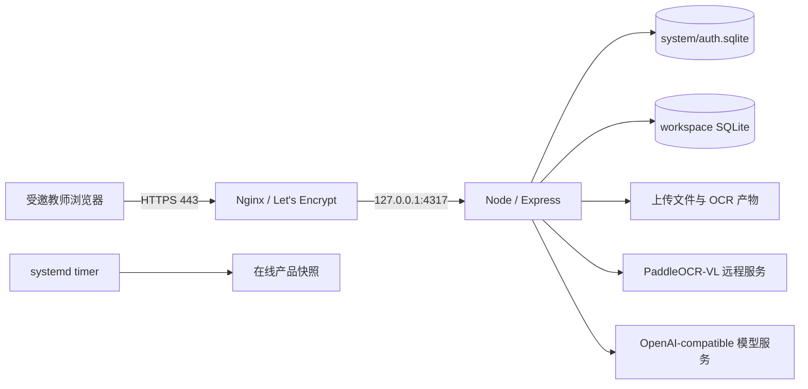

# 青松教师 项目当前交接

> 本文是当前统一交接入口。历史专项文档只用于追溯当时的决策，不再代表当前 Git、数据路径或部署状态。
> 更新时间：2026-10-23；当前应用生产提交：2d87132e1b838358d9393e41b7bd9cb170dcc957（PR #70）。

> 改名进度：中文品牌「青松教师」，英文项目名 `qingsong`；GitHub 仓库为 `CXC0515/qingsong`，母文件夹已迁至 `/Users/cxc/Projects/qingsong`。品牌代码经 PR #55 合并，已随PR #57部署服务器；实际切换与验证见 [改名记录](./QINGSONG_RENAME.md)。

## 1. 当前阶段与产品边界

### 2026-10-26 助手铺满右栏与重复文字（本地候选，未发布）

- 用户明确修正上一版：右栏宽度不变，助手从内容区顶部到底部；移除“快捷入口班级”可见文字，保留选择器；标签页删除内部重复面包屑/大标题。设计规范v1.4，上一版右上留白已被本次决策取代。
- 修改限于AppLayout、标签页、工作台网格样式和设计记录；不改数据/API/玻璃参数。用户提及的官方DeepSeek Harness仅做资料和代码对照评估，没有安装或接入。

### 2026-10-26 工作台布局与遗漏切换修正（本地候选，未发布）

- 用户确认工作台取消课堂任务预览、待处理教学任务、学情异常与关注；左上常用工作独立卡片2×2，虚拟教室并入；左下课表/日程独立模块，助手右下宽扁、右上留白。保留课表去记录/课次续接和日程条目展示待定。
- 同一独立分支/worktree续改，基线cfe25bd；fetch后origin/main仍3bd5313f。删掉工作台专用摘要请求与监听、无调用的展示派生和回调，不改业务接口或数据。
- 班级可视化记录操作移到标题后、班级选择前；日程四象限/清单、标签大类复用GlassSegments，旧选择实现移除。标签仍是原有本机演示，不宣称已持久化。
- 设计DESIGN.md v1.3，原始截图和实际检查见 `docs/qa/2026-10-26-workbench-layout/README.md`。1280×720工作台主区640/640不需整页下滑，助手约576×223；900×480主区400/400、助手372×170；375×568工作台/座位图/标签无页面横向溢出，标签四个大类均完整可点。没有新业务写入或生产操作，真实使用由用户验收。

### 2026-10-26 全站共享控件与表现轮次（本地候选，未发布）

- 用户批准全站收敛并续办；沿用本专项独立 worktree/分支。起点aae109b，重新fetch后origin/main仍3bd5313f。母文件夹原有改动保留。
- 当前设计DESIGN.md v1.2，具体方案/组件接入/表现schema16契约见 `WORKSPACE_UI_UNIFICATION.md`。E材质与运行文件不变；实际发现并移除旧淡入动画的持久合成层，修复玻璃选中片发灰。模式切换、常用按钮、字段、班级和一般弹窗收敛共享，专用阅卷/座位交互保留。
- 表现新一轮真实落库并按课次/自由记录、班级、项目和日期隔离；旧事件按第1轮读取，画像完整累计，本轮次数不受历史分页截断，幂等新建与原轮撤销。手机轮次移操作行，名单仍三列。
- 本地56项专项、类型检查、构建通过。1280/900/375实际壳层抽查见 `docs/qa/2026-10-26-unified-ui/README.md`。用户承担真实使用，未做真机/软键盘或跨浏览器完整验收。最后学生弹窗关闭检查遇到浏览器连接无响应，已修正基线误判并改成应用内二次确认，但关闭/继续编辑/放弃的最终交互未复核；旧提示若仍在需用户取消并刷新。
- 4414和4415已恢复为原隔离数据预览，数据仍在 `/tmp/qingsong-glass-preview-9mXhCd`；账号preview@example.com。测试班名当前已正常化，旧虚构任务/课表名称样例也正名，恢复点在 `/tmp/qingsong-preview-before-sample-name-20261026.sqlite`。没有正式数据迁移/推送/PR/合并/部署。

### 2026-10-24 原型还原修正（本地候选，未发布）

- 用户指出侧栏、轮次、搜索/日期与已确认原型不符，以及改名应位于项目行右侧；明确“同意”按审查方案修正。继续本专项独立 worktree/分支，基线本地候选a1daad1，origin/main仍3bd5313f；没有覆盖母文件夹文件。
- 桌面侧栏210px/中等宽度172px，品牌与账号回侧栏，扁平项目入口与安静分组标题，当前页单独高亮；保留所有导航、折叠、管理员、账号及手机抽屉。课次/自由记录移到轻顶栏；类别、班级、日期、轮次和页面切换紧凑编排，项目改名固定项目行右端。
- 共享RecordingFields统一找学生/说明外框与透明内部输入，日期透明、轮次轻文字；全局CSS导入顺序修正，避免外部字体import落到规则之后。未修改液态玻璃运行文件、E参数、后端、记录队列或数据库。
- 当前记录/视觉证据见根DESIGN.md v1.1、docs/qa/2026-10-24-ui/README.md。本轮仅本地候选，未推送/PR/合并/部署，原4414入口继续使用隔离数据。

### 2026-10-23 液态玻璃 UI 与真实课次/改名（本地候选，未发布）

- 用户批准最终 E 材质、统一浅阴影、设计规范与正式实现，并补充明确授权“课次自动续接、项目改名一起接入真实功能”。使用 `codex/qingsong-glass-ui` 独立 worktree，基线 origin/main@3bd5313f14e1afcb7e2f2f2b3654cef1ee9ef767；母文件夹原有未跟踪文件保留。
- 当前规范为根 `DESIGN.md`；`QINGSONG_UI_REDESIGN.md` 是原型历史。真实接口、迁移、快照/版本/恢复规则见 `CLASSROOM_LESSON_PROJECTS.md`。
- 共享 skill 运行文件、GlassSurface/Button/Segments、ClassPicker 接入。手机三列（极窄两列），姓名/学号固定槽位，负结果44px，补充说明始终展开。公共班级选择覆盖壳层、记录、诊断、可视化、班级课表。工作台课表、提醒、教学任务分区，保留助手空间；日程逐条展示待定。
- schema15只追加元数据表，保留旧记录作为自由记录。课表入口真实续接、默认/自建项目改名、未知结果查询、版本冲突、画像/历史当前名称投影已实现；自建目录改名同步旧 label 唯一约束列，使旧名可再次使用，事件不改写。
- 本地隔离试用：`http://localhost:4414/`，API4415，虚构40人/两节课；数据位于 `/tmp/qingsong-glass-preview-9mXhCd`，不与母文件夹或生产数据互通。当前进程是本轮临时试用，不是正式服务，系统重启后不会自动恢复。旧4412仍为静态原型。
- 类型检查/构建通过（构建仍有既有大包提示）；课堂专项29项、迁移/隔离/中断恢复/队列/投影19项通过。实际应用壳层快速核对工作台、课表入口、点名与改名；完整使用、手机真机、键盘与跨浏览器折射仍待用户。
- 已做本地代码 review，修正侧栏选中对比、学生状态布局、默认项目画像名称、旧名复用与持久化核对边界。没有推送/PR/合并/部署，没有生产迁移；发布前必须在线备份和校验各工作区迁移，不得将此候选当作线上版本。

### 2026-10-23 课堂紧凑布局与工具栏（已上线，待用户体验验收）

- 用户批准三项收敛及原Git／PR／合并／部署流程：新项目紧跟已有项目、学生卡片缩小、轮次操作合并。独立 worktree classroom-compact，基线origin/main@2e84b3e。PR #69于2026-10-21合并并部署为b8eeb63；续办时核对生产仍运行该提交，PR #70合并发布最终2d87132。
- 新项目回到横向列表末尾；卡片主体桌面56px、手机64px，负结果按钮至少44×44px，去掉每卡重复未登记文字。桌面自动填充列数，手机两列。轮次通过portal移入班级／日期行，其余操作合并搜索栏；可选输入自然展开，默认收起不占额外高度。
- 范围仅四个课堂界面组件及文档。保存Hook、队列、版本校验、服务接口与数据库不变，无迁移或真实数据覆盖。长项目列表需横向滚动到新项目；长姓名允许换行。未来Agent和其他页面未扩张。
- 2026-10-21隔离40人实际壳层检查：1280×720为6列／56px；375×568卡片64px、负结果44px，班级／日期／轮次同排；844×390无横向溢出。正负结果、刷新、新轮次隔离／回原轮次、本次记录、表现连记、新项目及名单末尾通过。补查说明／内容输入在375px下分别256px／192px，字体16px，430px展开无横向溢出。真机、软键盘和真实教师体验待用户验收。
- 最终发布：母文件夹main同步2d87132e1b838358d9393e41b7bd9cb170dcc957后打包，SHA256 328b7a4e5a8056729595828ba45a5ea6b3981e60e37211d4acacd325ae2c4e64。服务器独立安装、类型检查、构建、24项课堂及22项迁移／隔离／恢复／队列／投影测试通过；切换前确认无运行中长任务，并重新核对current未被其他发布改变。上一版b8eeb63保留。
- 公网live／ready、首页200、匿名项目接口401通过。入口index-DZQJ5Yp_.js，本地／服务器／公网解压SHA256一致：800cc90c692514cee4d3f86f3ee54653a89386b403a94171fdfc08a851483e7e。公网ready首查SSL连接超时，重试通过。7库完整性ok、3个roster仍14、外键错误0。服务active/running、NRestarts=0，备份timer active。启动等待的初次回环连接失败后恢复，没有触发回滚。未在真实班级写入验收记录；产品规则见CLASSROOM_TASKS_DESIGN.md第23节，入口 https://td.unreached.top/?page=classroom-tasks 。

### 2026-10-21 即时课堂记录与桌面工作台视口（已上线，待用户体验验收）

- 用户认可独立原型并批准整卡点击修订、沿原 Git／PR／合并／部署流程上线，同时要求工作台桌面端不再整页滚动。基线 origin/main@912bb3e，独立分支 codex/classroom-instant-recording，复用本会话独立 worktree；母文件夹原有未跟踪文档和数据保留。
- 整卡及“未登记”可点击，负结果独立；计数即时投影，表现支持同一学生连续点击。移除重复“正在记录”卡和单项更多，直接进入本次记录；项目单行选择、新项目入口固定。复用原名册、事件、补做、幂等写入及有序队列，没有新增接口或 schema。
- 未发送记录直接取消，发送中撤销以补偿事件排队并立即恢复界面；响应丢失／刷新后核对原操作，按 operationId 去重已回读事实。待核对时仍可保留后续点名。继续使用 sessionStorage，不承诺关闭标签页后恢复或离线自动重放；真实网络往返仍存在。浏览器无法保留撤销时原记录保留并提示恢复路径。
- Workbench／AppLayout 桌面外层固定剩余视口，长内容在区域内滚动；手机整页滚动。未来 Agent 仅建立高度边界，本次没有实现会话或输入框。
- 类型检查、构建、24项课堂测试和22项迁移／隔离／恢复／队列／投影测试通过。900ms延迟、40人实际壳层：十次连记、未发送取消／发送中撤销、刷新、39人批量及整批撤销、旧结果保留通过；375×568无横向溢出，第40人及批量确认可达；桌面1024×600、1280×720外层scrollHeight=clientHeight，12项待跟进仍不撑高页面。真机、软键盘及真实教师体验由用户验收。
- PR #67 合并为23a236113ce9b55eac5a7e39e55a39bb4952b863；母文件夹main同步后打包，SHA256 d90ab69ace677af67ee06d3cb30482253359872c28dbf6ce59e3debe039a822e。服务器独立安装、类型检查、构建及24＋22项测试通过，current切至对应release，上一版ea04d2a保留。未执行数据迁移或覆盖；7库完整性ok、3个roster仍14、外键错误0、切换前无运行中长任务。
- 回环及公网live／ready通过，首页200、匿名项目接口401；入口index-LHI7daPb.js，本地／服务器／公网解压SHA256一致：206118e4333198d173d8be424eb543bb9fdc5aca2ae8d6a05d2930a94dd726fa。服务active/running、NRestarts=0，备份timer active。启动等待初次连接失败后恢复，未触发回滚。测试入口 https://td.unreached.top/?page=classroom-tasks ，原账号刷新；工作台直接从左侧进入。未在真实班级写入测试记录。产品与限制见 CLASSROOM_TASKS_DESIGN.md 第22节。

### 2026-10-21 课堂状态条、轮次与批量范围（已上线，待用户体验验收）

- 用户批准四项收敛及提交／部署：保存状态并入“正在记录”条、轮次旁显示新一轮检查、批量范围移入弹窗、待跟进／历史显示日期与轮次。基线origin/main@cf9c787，分支codex/classroom-round-controls，复用本会话独立worktree。
- 复用原保存队列、预览及写入接口。删除普通保存状态的整行占位，异常核对仍保留。首笔前撤销按钮固定为禁用，避免首笔后按钮出现导致手机名单换行。新一轮在首笔保存时建立，旧检查及任务判定规则不变。
- 快记与详情共用范围选择组件；显示范围总人数和可填写人数，仅填写未记录者。详情切换范围重取原服务端预览，过期响应不覆盖新选择。列表round可选字段从已有轮次关联一次读取，旧手工检查不推测轮次；无schema或数据迁移。
- 本地24项专项及17项迁移／隔离／恢复／队列测试通过，类型检查、构建通过。临时40人实际壳层验证新轮次首笔、原结果隔离、同名第1／2轮待跟进、快记与详情分别按筛选保存1人并保留旧结果。375×568无横向溢出，名单位置保存前／中／后均679；手机及桌面信息条已查看，真机与软键盘待用户。
- PR #65 合并为ea04d2adfb79863bcba690efd28613491570d4f5；母文件夹main同步打包，SHA256 14c17977c220dbb62ec789c91dc903167df9b1fa4347f1e8ec33711cfd4ebd54。服务器独立安装、类型检查、构建及24＋17项测试通过，current切到对应release，上一版c143a6f保留。
- 无schema或真实数据迁移；7库完整性ok，3个roster仍为14，外键错误0。公网live／ready、首页200、匿名项目接口401正常；入口index-2s8Xc6mB.js，本地／服务器／公网解压SHA256一致：f4f4a0f2b22a3132c335331e5692a09f830e21f742ee50ed2c3e02e5a43b5c4f；gzip／Vary保留。服务active/running、NRestarts=0，备份timer active。
- 原账号刷新 https://td.unreached.top/?page=classroom-tasks 体验；未在真实班级写入验收记录，真机与软键盘仍待用户。产品细则见 CLASSROOM_TASKS_DESIGN.md 第21节。

### 2026-10-21 课堂连续快记与滚动修复（已上线，待用户体验验收）

- 用户逐项反馈名单延迟、重复文案、完成／通过选择、保存变灰和待确认、不能下滑、重复建设、归档不可见；批准收敛方案及 Git／PR／合并／部署。从 origin/main@21ee244 建立 codex/classroom-recording-flow，复用本会话独立 worktree。
- 共享有序保存队列，点名立即反馈，普通提交只锁该学生，其他学生可继续点；使用返回结果更新，移除每笔保存后的重复读取。超时或丢响应才核对；保存精确请求和操作ID，刷新后显式核对／重试，不静默补发。
- 复用 App 已加载名册与按账号隔离的项目显示缓存；历史检查参与范围和版本仍由服务器核验。完成／通过改为可选展开，表现卡片移除重复“项目名·记一笔”；恢复壳层页面滚动，历史卡片直接归档／恢复，复用原生命周期接口。
- 本地24项专项、10项迁移／隔离／恢复、7项队列测试通过，类型检查及构建通过。700ms延迟下两种快记连续三人成功且无重复名单读取；模拟已保存丢响应后核对并续存，无重复事件；补交／撤销、归档／恢复通过。375×568实际滑到第40名和来源入口，宽度375无横向溢出；真机及软键盘待用户。
- PR #63 合并为 c143a6f42900820e35ac7fa68a9c6c59b7eb8603；从母文件夹 main 打包，SHA256 5a50bb576ca1cd5a1aba65b8f3819db864903579e93d36bc895c53d95a3af14d；服务器 current 已指向对应 release，上一版 ba915c9 保留。服务器独立安装、类型检查、构建、24＋17项测试通过。
- 无服务端逻辑、配置或数据结构变更，没有执行数据迁移或恢复；原独立恢复点保留，roster仍为14。发布后7 SQLite完整性ok、3个roster版本14、外键错误0；服务active/running、NRestarts=0，备份timer active。
- 公网live／ready正常、首页200、匿名项目接口401；当前入口 index-Iq-ZZWHu.js，本地／服务器／公网解压SHA256一致：28a0f25627f7d6492262288229b3d43ef8833a9c7b52dc5d8e9fc41055d8221b。gzip与Vary正常。启动窗口初次健康连接失败后恢复，无回滚。
- 刷新 https://td.unreached.top/?page=classroom-tasks 试用；未在真实班级写入测试记录。网络往返仍存在，局部即时反馈和后台队列不代表提前确认落库；真机与真实网络连续点名待用户验收。具体规则和取舍见 CLASSROOM_TASKS_DESIGN.md 第20节。

### 2026-10-21 自定义课堂项目与紧凑界面（已上线，待用户体验验收）

- 从 origin/main@527b523 创建 codex/classroom-projects-ui，复用本会话独立 worktree；母文件夹原有未跟踪文档及数据保留。
- 学业／表现均可新建项目，跨班复用目录、记录按班隔离，首笔自动建轮；紧凑名单、点击姓名记录，画像显示自定义表现名称。
- 迁移14仅追加项目表；本地24＋10项测试、类型检查和构建通过。40人实际壳层完成新建／刷新／记录／画像核对；窄矮屏无横向溢出、弹窗保存可见，真机与软键盘待用户。
- PR #61 合并为 ba915c9204f691460c527d0c3f7efd0a9b7116bf；母文件夹 main 同步后打包，SHA256 45fe60a94b927d9e13493b8a6d79bba91c63a300dea504f34ab4fc23c0971ce0；服务器 current 已切换到对应 releases 目录，上一版 7d9e590 保留。
- 停写后在线恢复点 /var/lib/teacher-dashboard/backups/manual/product-2026-10-21-pre-projects-ba915c9，1285文件／7 SQLite，清单哈希验证通过；3个工作区 roster 13→14，旧表计数一致、完整性ok、外键错误0。服务器独立安装、类型检查、构建、24＋10项测试通过。
- 公网live／ready正常、首页200、匿名项目目录401；入口 index-ivRBKN90.js 与本地及服务器构建一致，解压SHA256 a3a9bd46b34d17c580a281c382373fed1aa3052c9013af6284fc7776a7169229；gzip及Vary保留。服务active/running，NRestarts=0。启动等待前几次连接失败后健康恢复，未回滚数据。
- 原账号刷新 https://td.unreached.top/?page=classroom-tasks 后，在学业／表现两行“＋新项目”试用。未向真实班级写入验收记录；真机和软键盘由用户验收。边界见 CLASSROOM_TASKS_DESIGN.md 第19节。

### 2026-10-20 课堂快记与画像联动（已上线，待用户体验验收）

- 本次授权含独立分支、实现、PR、合并和部署；用户负责上线后的真实功能体验及真机详细验收。
- 从 origin/main@b978576 创建 codex/classroom-quick-profile，独立 worktree /Users/cxc/.codex/worktrees/classroom-quick-profile/qingsong。
- 任务首笔自动建轮、当日续接、同日多轮、批量例外；表现事件快记与撤销；画像近7／30天汇总及来源；观察改为真实保存、实际日期和操作者。
- 追加 roster 迁移13三表，不重写旧任务、标签或观察。旧深链继续定位原检查；自动检查日期固定，防止日期修订破坏续接。
- 本地21项专项及10项迁移／隔离／在线备份恢复测试通过；类型检查和构建通过（既有大chunk提示保留）。12人临时账号完成真实登录壳层首笔、续接、表现、画像、观察保存，375×667无横向溢出；未做真实教师／真机／软键盘完整验收。
- PR #59 已合并为 7d9e590ba2fc3ddf7d72838768acb70270a6b8d5；母文件夹 main 同步后打包，SHA256 41d939605693b56c9f5a2e06434252564e9075e86c02a57d58be9dd25238a3be。服务器 current 已切换至 /opt/teacher-dashboard/releases/7d9e590ba2fc3ddf7d72838768acb70270a6b8d5，旧 bb87221 保留。
- 停写后在线恢复点：/var/lib/teacher-dashboard/backups/manual/product-2026-10-20-pre-quick-7d9e590；1285文件／7 SQLite，清单哈希及完整性复核通过。3个工作区 roster 12→13；7库完整性ok、外键错误0，旧名册表计数与恢复点一致。
- 服务器独立 npm ci、类型检查、构建和21＋10项测试通过；公网live／ready正常、首页200、匿名快记与表现接口401；页面入口JS与本地构建同为 index-DcakueF8.js。服务active/running、NRestarts=0，备份timer active。
- 发布回执SSH连接中断，随后独立复核current、日志、恢复点、7库及公网确认部署完成，没有盲目重跑迁移或恢复旧数据。未更改域名、密钥、上海实例，未在真实班级写入验收记录。
- 测试入口：https://td.unreached.top/?page=classroom-tasks；原账号登录并刷新页面。“记录”下切换学习检查／课堂表现，学情诊断→学生画像查看近7／30天和来源。真实教师、真机及软键盘体验待用户验收；详细规则、限制见 CLASSROOM_TASKS_DESIGN.md 第18节。

### 2026-10-20 课堂任务专项（已上线，待真实教师验收）

- 基线：origin/main fddf8ef；独立分支 codex/classroom-tasks，worktree /Users/cxc/Projects/qingsong-classroom-tasks。母文件夹原有方案和数据未改动。
- 已实现：任务固定名册、单人／批量预览与保存、补测／纠错／撤销、历史、免做与参与调整、生命周期、首页／教室／学生画像入口。
- 持久化：在工作区roster.sqlite追加迁移12的四张表；沿用工作区鉴权及在线快照恢复，不回填旧观察。
- 已验证：78项领域／HTTP／迁移／隔离／认证／备份等测试、TypeScript与构建；临时账号40人名册的真实应用壳层流程、断网确认丢失核对及防重复、8种尺寸和200%缩放。详情见CLASSROOM_TASKS_DESIGN.md第15节。
- 发布：PR #57已合并并上线，入口https://td.unreached.top/?page=classroom-tasks，使用原账号。真实教师及真机操作待用户验收，发布证据见文末。

青松教师 已进入少量受邀教师使用的海外单实例生产阶段。

- 生产入口：`https://td.unreached.top`
- 生产实例：腾讯云 Lighthouse `lhins-mtpcwz75`，硅谷二区，Ubuntu 26.04，公网 IP `43.172.77.153`
- 运行规格：2 vCPU、2 GB 内存、50 GB SSD、30 Mbps 峰值带宽、2 GB swap
- 用户：管理员 Cleo 与最多两名受邀教师
- 身份边界：邀请注册、密码登录、管理员权限、每教师独立工作区
- 上海实例不运行 青松教师，后续单独用于 Hermes；本次没有修改该实例
- 暂不承诺：内地不同运营商可达率、多人高并发、跨实例容灾和异地备份

## 2. 当前生产架构

- DNS：阿里云 `td` A 记录指向 `43.172.77.153`，TTL 10 分钟。
- 公网只使用 80/443；80 自动跳转 HTTPS，应用端口 4317 只监听回环。
- 服务：`teacher-dashboard.service`；每日备份：`teacher-dashboard-backup.timer`。
- 代码：2026-10-23核对current指向/opt/teacher-dashboard/releases/2d87132e1b838358d9393e41b7bd9cb170dcc957，对应PR #70；上一版b8eeb63保留，未清理其他发布目录。
- 数据：`/var/lib/teacher-dashboard/product-2026-09-16-r2`。
- 证书：Let's Encrypt，当前证书到期日 2026-12-15，Certbot 自动续期。
- 健康检查：`/api/health/live` 与 `/api/health/ready`。

## 3. 数据权威性与恢复边界

- 当前生产运行权威数据已切换为服务器目录 `/var/lib/teacher-dashboard/product-2026-09-16-r2`。
- 迁移源 `/Users/cxc/Projects/qingsong/var-product` 与手工恢复点 `/Users/cxc/Projects/qingsong/var/backups/product-2026-09-16-pre-overseas-cutover` 保留为切换前回滚证据，不再接受生产写入。
- 迁移快照包含 1,255 个产品文件和 5 个 SQLite，约 506 MiB；本地和服务器端的清单哈希、数据库完整性检查均通过。
- 服务器原始快照保留在 `/var/lib/teacher-dashboard/snapshots/product-2026-09-16-pre-overseas-cutover`。
- 首次恢复因 macOS `.DS_Store` 被误判为工作区而失败，失败目录 `/var/lib/teacher-dashboard/product-2026-09-16` 保留用于调查；修复经 PR #24 合并后恢复到全新 `-r2` 目录成功。
- 自动备份目录为 `/var/lib/teacher-dashboard/backups/automatic`；首次手工触发的服务器在线备份已成功。
- 若上线后产生新写入，不得用本地旧副本覆盖服务器数据；回滚前必须冻结写入、保留两边并制定差异处理方案。

## 4. Git 与协作基线

- GitHub `origin/main` 是唯一稳定基线；2026-09-20 核对生产应用运行 `693b534`（PR #41）。
- PR #24 修复产品恢复工具：只遍历实际工作区目录，忽略 `.DS_Store` 等非目录元数据；聚焦测试 4/4 和 lint 通过。
- 母文件夹固定为 `/Users/cxc/Projects/qingsong`；正式发布只能来自已合并的 `origin/main`，不得长期依赖临时 worktree。
- 真实环境变量只存于服务器 `/etc/teacher-dashboard/teacher-dashboard.env`，权限 `600 root:root`；不得提交或输出密钥。
- 后续修改继续遵守根目录 `AGENTS.md` 的方案、授权、验证和 Git 边界。

## 5. 已完成验收

- 2026-09-23：PR #46 材料池首版发布为 `54b3159`。生产迁移前在线恢复点 `/var/lib/teacher-dashboard/backups/manual/product-2026-09-23-pre-material-pool` 已创建并验证，包含 1,285 个文件和 7 个 SQLite。服务器 `npm ci`、lint、build 及 20 项材料池、资料库和备份恢复测试通过；三个教师工作区均迁移到资源库 schema v9，SQLite `integrity_check=ok`、外键错误 0、旧资源引用缺失 0。回环与公网 live/ready、新静态资源通过，材料池接口未登录返回 401。真实账号上传、手机手势、Office 原件和从材料池选用 PDF 仍待用户验收。

- 2026-09-18：PR #39–#41 依次发布为 `a4cfddf`、`4f66a22`、`693b534`。资料编辑从 PDF.js 页面阅读切回浏览器原生 PDF；#39 调整加载提示和移动端课表入口，#40 保留最近 3 份原生阅读器并调整课表与工作台布局，#41 修正缓存重排导致的 iframe 重建。各次 TypeScript、生产构建和回环/公网 live、ready 检查通过，未修改生产数据。**手机端 A→B→A 不再重复加载的最终体验尚待用户复测确认**；健康检查和构建通过不能代替该验收。
- 2026-09-18：PR #35–#38 记录并迭代 PDF 阅读器、加载反馈和桌面标签可读性。其中 #36 曾采用渐进 PDF.js 渲染，#37 改用浏览器原生 PDF；以下 #34 记录仅反映当时版本，不代表当前阅读器实现。
- 2026-09-17：PR #34 PDF 阅读与移动选择器修复已发布为 `fd0f8f7`；资料 PDF 改为 PDF.js canvas 渲染，支持翻页、缩放、适应宽度、打开原文件及上传前首页预览；课表班级、资料类型、知识图谱学科和图谱筛选改为手机大选项面板。lint/build 通过，1440×900 与 390×844 Chromium 实际渲染及翻页通过，回环与公网 live/ready 正常；未修改生产数据、数据库结构或环境变量。
- 2026-09-17：PR #32 手机控件第三轮收敛已发布为 `80787d5`；座位图控件同排，座位图及学情诊断使用大选项班级面板，日程去除冗余状态行并恢复隐藏筛选，标签启停具有勾选状态。lint/build 与 390×844 Chromium 关键交互通过，回环及公网 live/ready 正常；未修改生产数据、数据库结构或环境变量。
- 2026-09-17：PR #30 移动端第二轮精修已发布为 `d0dead8`；座位表导出学号偏好移入设置，学生、日程、标签、班级归档、学情诊断和 AI 批改手机布局收敛。本地 lint/build 通过，390×844 真实 Chromium 逐页渲染与关键弹层交互通过，1440×900 桌面回归通过；服务器独立 npm ci/build 通过，回环及公网 live/ready 正常。未修改生产数据、数据库结构或环境变量。
- 2026-09-17：PR #28 座位图手机工具区、行列坐标和放大预览已发布为 `b13be36`；本地 lint/build 通过，390×844、844×390 和 1440×900 Chromium 渲染验收通过；服务器独立 npm ci/build 通过，回环及公网 live/ready 正常。已删除旧代码目录 `03b3a0d`、`0a7b95f`，保留 `9837298` 回滚；生产数据和备份未修改。
- 2026-09-17：PR #26 移动端管理优化已发布；服务器 npm ci、lint、build、座位测试 4/4 通过，回环及公网 live/ready 正常；公网静态资源哈希与新构建一致，5 个 SQLite 完整性和关键计数通过。保留旧发布目录 `03b3a0d`。本次仅更新代码，未修改生产数据目录或数据库结构。
- 手机班级详情改为底部面板，新增学生画像按钮、座位快捷换位，课表紧凑展示、四象限 2×2、标签四类同一行。完整验收及限制见 [MOBILE_MANAGEMENT_RELEASE.md](./MOBILE_MANAGEMENT_RELEASE.md)。

- 权威 DNS 与公共递归解析均返回 `43.172.77.153`。
- 云防火墙已允许 22、80、443；UFW 允许 OpenSSH 与 Nginx Full。
- Nginx 配置检查通过，公网 HTTP 自动跳转 HTTPS。
- 公网 `https://td.unreached.top/api/health/live` 返回 `{"ok":true}`。
- 服务器 `ready` 返回存储 ready，并确认 AI 与 PaddleOCR 已配置；这不等于真实调用成功。
- 未登录 `/api/classes` 返回 401。
- Playwright 真实打开 HTTPS 首页，看到“UNREACHED 教师工作台”“欢迎回来”和登录表单，无证书拦截页。
- 浏览器控制台中的 `/api/account` 401 是未登录状态的预期请求；Google Fonts 被现有 CSP 阻止是低优先级样式依赖问题，不影响登录页和服务可用性。

## 6. 已落地能力

- 班级、学生、座位图、班委、课表、日程和系统设置。
- 作业图片 OCR、AI 试批、证据复核、学情诊断和教师终审。
- PDF 资料上传、分页 PaddleOCR、原文/OCR 阅读、知识检索与知识结构建议。
- 邀请注册、管理员门禁、会话保护、跨用户工作区隔离和受保护资料下载。
- PaddleOCR 原始块类型、Markdown、坐标和图片引用持久保存；表格、图片和公式安全渲染。

关键控制边界：OCR 与 AI 只产生可追溯草稿或建议；教师确认前不得静默改变正式知识结构或评分结果。局部解析失败应隔离，不阻塞已完成页面。

## 7. 当前风险与下一步

1. 尚未主动消耗真实 AI/OCR 调用额度；首次真实使用时分别确认供应商调用、任务状态和人工重试链路。
2. 最近原生 PDF 缓存修正已部署，但尚未取得用户在真实手机上完成 A→B→A 复测的确认；不以服务健康或服务器请求日志单独宣称阅读体验已修复。
3. 硅谷到中国内地的延迟和运营商可达性需由两名实际用户在各自网络中验证。
4. 自动备份与生产数据仍在同一实例，只能处理误操作和逻辑损坏，不能覆盖整机故障；规模扩大后再评估异地加密备份。
5. 2 GB 内存适合当前小规模试用，不代表可承载高并发 OCR/AI 任务。
6. 材料池服务端迁移和权限边界已验证，但尚未使用真实教师账号完成「上传 → 文件夹整理 → 资料编辑选用 PDF」的生产闭环；上线健康检查不能替代这项验收。
7. PR #48 修正材料池手机布局，尚未用真实账号在手机上完成列表滚动、快速整理和文件夹操作验收。

运维、发布和证书操作见 [WEB_OPERATIONS_RUNBOOK.md](./WEB_OPERATIONS_RUNBOOK.md)；数据恢复见 [WEB_DATA_MIGRATION_RUNBOOK.md](./WEB_DATA_MIGRATION_RUNBOOK.md)；本次部署证据见 [OVERSEAS_PRODUCTION_DEPLOYMENT.md](./OVERSEAS_PRODUCTION_DEPLOYMENT.md)。

## 8. 修改历史

| 版本 | 日期 | 状态 | 修改概要 |
| --- | --- | --- | --- |
| v1.0-v2.5 | 2026-09-06 至 2026-09-12 | 已归档 | 本地原型、Cloudflare Tunnel、国内实例演练和备案期间下线状态。 |
| v3.0 | 2026-09-16 | 历史 | 记录硅谷生产切换、`td.unreached.top`、权威数据 `-r2`、HTTPS、自动备份及最小公网验收。 |
| v3.1 | 2026-09-17 | 历史 | PR #26 手机管理体验发布至硅谷实例，应用提交 9837298，数据目录保持 -r2。 |
| v3.2 | 2026-09-17 | 历史 | PR #28 座位编辑响应式收敛与放大预览发布为 b13be36；清理两个旧代码目录，保留 9837298 回滚，数据目录保持 -r2。 |
| v3.3 | 2026-09-17 | 历史 | PR #30 移动端第二轮精修发布为 d0dead8；保留 b13be36 与 9837298 回滚，数据目录保持 -r2。 |
| v3.4 | 2026-09-17 | 历史 | PR #32 手机控件第三轮收敛发布为 80787d5；数据目录保持 -r2。 |
| v3.5 | 2026-09-17 | 历史 | PR #34 PDF.js 阅读器、上传前首页预览和移动选择器修复发布为 fd0f8f7；数据目录保持 -r2。 |
| v3.6 | 2026-09-20 | 历史 | 核对生产指向 693b534，补记 PR #35–#41 的 PDF/移动端发布历程和手机 A→B→A 待验收状态；数据目录保持 -r2。 |
| v3.7 | 2026-09-23 | 历史 | PR #46 材料池发布为 54b3159；记录迁移前手工恢复点、三个工作区 schema v9 验证、线上健康边界与真实账号待验收项。 |
| v3.8 | 2026-09-23 | 历史 | PR #48 手机壳层滚动与快速整理预览高度修正发布为 88bf9f5；本地 lint/build、服务器 build、回环与公网健康通过，真实账号手机操作待复测。 |
| v3.9 | 2026-10-12 | 当前 | 按用户批准清理 15 个旧发布目录，仅保留运行中的 88bf9f5；发布目录由约 7.2 GB 降至 484 MB，服务和公网健康正常；生产数据与备份未触及。 |

## 2026-10-20 课堂任务生产发布证据

- PR #57合并为bb87221542e70fe5651a62e3d0ab2a854efdabdd；母文件夹同步main后打包，SHA256 a7cc7e439007bec5a81ff736e35f8a24192bbf18750f06f53c391e6ac95c8d13。
- 服务器current由实际旧版4f26912切换至/opt/teacher-dashboard/releases/bb87221；服务器独立npm ci、lint、build及17项专项测试通过。
- 停写后在线恢复点/var/lib/teacher-dashboard/backups/manual/product-2026-10-20-pre-classroom-bb87221已校验，1285文件／7 SQLite；3个工作区roster 11→12，7库完整性、外键及旧表计数一致。
- 回环／公网live、ready、首页200及匿名任务API401通过；服务active/running，NRestarts=0，备份timer active。首页和JS哈希与服务器一致。
- 测试入口https://td.unreached.top/?page=classroom-tasks，用原账号；真实教师及真机触控待用户验收。保留旧release及恢复点，不改域名、密钥，不清理真实数据。
- 发布前路径核查拦住一次错误构建命令；改为服务器脚本后真正构建通过。迁移遇非工作区项时中止并恢复旧服务，收紧至实际数据库后重新核验恢复点并完成迁移。
