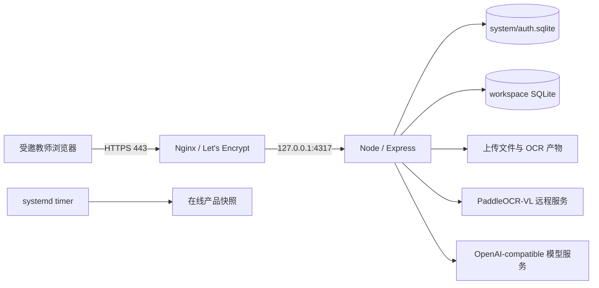

# 青松教师 项目当前交接

> 本文是当前统一交接入口。历史专项文档只用于追溯当时的决策，不再代表当前 Git、数据路径或部署状态。
> 更新时间：2026-10-20；当前应用生产提交：7d9e590ba2fc3ddf7d72838768acb70270a6b8d5（PR #59）。

> 改名进度：中文品牌「青松教师」，英文项目名 `qingsong`；GitHub 仓库为 `CXC0515/qingsong`，母文件夹已迁至 `/Users/cxc/Projects/qingsong`。品牌代码经 PR #55 合并，已随PR #57部署服务器；实际切换与验证见 [改名记录](./QINGSONG_RENAME.md)。

## 1. 当前阶段与产品边界

### 2026-10-20 课堂快记与画像联动（已上线，待用户体验验收）

- 本次授权含独立分支、实现、PR、合并和部署；用户负责上线后的真实功能体验及真机详细验收。
- 从 origin/main@b978576 创建 codex/classroom-quick-profile，独立 worktree /Users/cxc/.codex/worktrees/classroom-quick-profile/qingsong。
- 任务首笔自动建轮、当日续接、同日多轮、批量例外；表现事件快记与撤销；画像近7／30天汇总及来源；观察改为真实保存、实际日期和操作者。
- 追加 roster 迁移13三表，不重写旧任务、标签或观察。旧深链继续定位原检查；自动检查日期固定，防止日期修订破坏续接。
- 本地21项专项及10项迁移／隔离／在线备份恢复测试通过；类型检查和构建通过（既有大chunk提示保留）。12人临时账号完成真实登录壳层首笔、续接、表现、画像、观察保存，375×667无横向溢出；未做真实教师／真机／软键盘完整验收。
- PR #59 已合并为 7d9e590ba2fc3ddf7d72838768acb70270a6b8d5；母文件夹 main 同步后打包，SHA256 41d939605693b56c9f5a2e06434252564e9075e86c02a57d58be9dd25238a3be。服务器 current 已切换至 /opt/teacher-dashboard/releases/7d9e590ba2fc3ddf7d72838768acb70270a6b8d5，旧 bb87221 保留。
- 停写后在线恢复点：/var/lib/teacher-dashboard/backups/manual/product-2026-10-20-pre-quick-7d9e590；1285文件／7 SQLite，清单哈希及完整性复核通过。3个工作区 roster 12→13；7库完整性ok、外键错误0，旧名册表计数与恢复点一致。
- 服务器独立 npm ci、类型检查、构建和21＋10项测试通过；公网live／ready正常、首页200、匿名快记与表现接口401；页面入口JS与本地构建同为 index-DcakueF8.js。服务active/running、NRestarts=0，备份timer active。
- 发布回执SSH连接中断，随后独立复核current、日志、恢复点、7库及公网确认部署完成，没有盲目重跑迁移或恢复旧数据。未更改域名、密钥、上海实例，未在真实班级写入验收记录。
- 测试入口：https://td.unreached.top/?page=classroom-tasks；原账号登录并刷新页面。“记录”下切换学习检查／课堂表现，学情诊断→学生画像查看近7／30天和来源。真实教师、真机及软键盘体验待用户验收；详细规则、限制见 CLASSROOM_TASKS_DESIGN.md 第18节。

### 2026-10-20 课堂任务专项（已上线，待真实教师验收）

- 基线：origin/main fddf8ef；独立分支 codex/classroom-tasks，worktree /Users/cxc/Projects/qingsong-classroom-tasks。母文件夹原有方案和数据未改动。
- 已实现：任务固定名册、单人／批量预览与保存、补测／纠错／撤销、历史、免做与参与调整、生命周期、首页／教室／学生画像入口。
- 持久化：在工作区roster.sqlite追加迁移12的四张表；沿用工作区鉴权及在线快照恢复，不回填旧观察。
- 已验证：78项领域／HTTP／迁移／隔离／认证／备份等测试、TypeScript与构建；临时账号40人名册的真实应用壳层流程、断网确认丢失核对及防重复、8种尺寸和200%缩放。详情见CLASSROOM_TASKS_DESIGN.md第15节。
- 发布：PR #57已合并并上线，入口https://td.unreached.top/?page=classroom-tasks，使用原账号。真实教师及真机操作待用户验收，发布证据见文末。

青松教师 已进入少量受邀教师使用的海外单实例生产阶段。

- 生产入口：`https://td.unreached.top`
- 生产实例：腾讯云 Lighthouse `lhins-mtpcwz75`，硅谷二区，Ubuntu 26.04，公网 IP `43.172.77.153`
- 运行规格：2 vCPU、2 GB 内存、50 GB SSD、30 Mbps 峰值带宽、2 GB swap
- 用户：管理员 Cleo 与最多两名受邀教师
- 身份边界：邀请注册、密码登录、管理员权限、每教师独立工作区
- 上海实例不运行 青松教师，后续单独用于 Hermes；本次没有修改该实例
- 暂不承诺：内地不同运营商可达率、多人高并发、跨实例容灾和异地备份

## 2. 当前生产架构

- DNS：阿里云 `td` A 记录指向 `43.172.77.153`，TTL 10 分钟。
- 公网只使用 80/443；80 自动跳转 HTTPS，应用端口 4317 只监听回环。
- 服务：`teacher-dashboard.service`；每日备份：`teacher-dashboard-backup.timer`。
- 代码：2026-10-20核对current指向/opt/teacher-dashboard/releases/7d9e590ba2fc3ddf7d72838768acb70270a6b8d5，对应PR #59；上一版bb87221保留，未清理其他发布目录。
- 数据：`/var/lib/teacher-dashboard/product-2026-09-16-r2`。
- 证书：Let's Encrypt，当前证书到期日 2026-12-15，Certbot 自动续期。
- 健康检查：`/api/health/live` 与 `/api/health/ready`。

## 3. 数据权威性与恢复边界

- 当前生产运行权威数据已切换为服务器目录 `/var/lib/teacher-dashboard/product-2026-09-16-r2`。
- 迁移源 `/Users/cxc/Projects/qingsong/var-product` 与手工恢复点 `/Users/cxc/Projects/qingsong/var/backups/product-2026-09-16-pre-overseas-cutover` 保留为切换前回滚证据，不再接受生产写入。
- 迁移快照包含 1,255 个产品文件和 5 个 SQLite，约 506 MiB；本地和服务器端的清单哈希、数据库完整性检查均通过。
- 服务器原始快照保留在 `/var/lib/teacher-dashboard/snapshots/product-2026-09-16-pre-overseas-cutover`。
- 首次恢复因 macOS `.DS_Store` 被误判为工作区而失败，失败目录 `/var/lib/teacher-dashboard/product-2026-09-16` 保留用于调查；修复经 PR #24 合并后恢复到全新 `-r2` 目录成功。
- 自动备份目录为 `/var/lib/teacher-dashboard/backups/automatic`；首次手工触发的服务器在线备份已成功。
- 若上线后产生新写入，不得用本地旧副本覆盖服务器数据；回滚前必须冻结写入、保留两边并制定差异处理方案。

## 4. Git 与协作基线

- GitHub `origin/main` 是唯一稳定基线；2026-09-20 核对生产应用运行 `693b534`（PR #41）。
- PR #24 修复产品恢复工具：只遍历实际工作区目录，忽略 `.DS_Store` 等非目录元数据；聚焦测试 4/4 和 lint 通过。
- 母文件夹固定为 `/Users/cxc/Projects/qingsong`；正式发布只能来自已合并的 `origin/main`，不得长期依赖临时 worktree。
- 真实环境变量只存于服务器 `/etc/teacher-dashboard/teacher-dashboard.env`，权限 `600 root:root`；不得提交或输出密钥。
- 后续修改继续遵守根目录 `AGENTS.md` 的方案、授权、验证和 Git 边界。

## 5. 已完成验收

- 2026-09-23：PR #46 材料池首版发布为 `54b3159`。生产迁移前在线恢复点 `/var/lib/teacher-dashboard/backups/manual/product-2026-09-23-pre-material-pool` 已创建并验证，包含 1,285 个文件和 7 个 SQLite。服务器 `npm ci`、lint、build 及 20 项材料池、资料库和备份恢复测试通过；三个教师工作区均迁移到资源库 schema v9，SQLite `integrity_check=ok`、外键错误 0、旧资源引用缺失 0。回环与公网 live/ready、新静态资源通过，材料池接口未登录返回 401。真实账号上传、手机手势、Office 原件和从材料池选用 PDF 仍待用户验收。

- 2026-09-18：PR #39–#41 依次发布为 `a4cfddf`、`4f66a22`、`693b534`。资料编辑从 PDF.js 页面阅读切回浏览器原生 PDF；#39 调整加载提示和移动端课表入口，#40 保留最近 3 份原生阅读器并调整课表与工作台布局，#41 修正缓存重排导致的 iframe 重建。各次 TypeScript、生产构建和回环/公网 live、ready 检查通过，未修改生产数据。**手机端 A→B→A 不再重复加载的最终体验尚待用户复测确认**；健康检查和构建通过不能代替该验收。
- 2026-09-18：PR #35–#38 记录并迭代 PDF 阅读器、加载反馈和桌面标签可读性。其中 #36 曾采用渐进 PDF.js 渲染，#37 改用浏览器原生 PDF；以下 #34 记录仅反映当时版本，不代表当前阅读器实现。
- 2026-09-17：PR #34 PDF 阅读与移动选择器修复已发布为 `fd0f8f7`；资料 PDF 改为 PDF.js canvas 渲染，支持翻页、缩放、适应宽度、打开原文件及上传前首页预览；课表班级、资料类型、知识图谱学科和图谱筛选改为手机大选项面板。lint/build 通过，1440×900 与 390×844 Chromium 实际渲染及翻页通过，回环与公网 live/ready 正常；未修改生产数据、数据库结构或环境变量。
- 2026-09-17：PR #32 手机控件第三轮收敛已发布为 `80787d5`；座位图控件同排，座位图及学情诊断使用大选项班级面板，日程去除冗余状态行并恢复隐藏筛选，标签启停具有勾选状态。lint/build 与 390×844 Chromium 关键交互通过，回环及公网 live/ready 正常；未修改生产数据、数据库结构或环境变量。
- 2026-09-17：PR #30 移动端第二轮精修已发布为 `d0dead8`；座位表导出学号偏好移入设置，学生、日程、标签、班级归档、学情诊断和 AI 批改手机布局收敛。本地 lint/build 通过，390×844 真实 Chromium 逐页渲染与关键弹层交互通过，1440×900 桌面回归通过；服务器独立 npm ci/build 通过，回环及公网 live/ready 正常。未修改生产数据、数据库结构或环境变量。
- 2026-09-17：PR #28 座位图手机工具区、行列坐标和放大预览已发布为 `b13be36`；本地 lint/build 通过，390×844、844×390 和 1440×900 Chromium 渲染验收通过；服务器独立 npm ci/build 通过，回环及公网 live/ready 正常。已删除旧代码目录 `03b3a0d`、`0a7b95f`，保留 `9837298` 回滚；生产数据和备份未修改。
- 2026-09-17：PR #26 移动端管理优化已发布；服务器 npm ci、lint、build、座位测试 4/4 通过，回环及公网 live/ready 正常；公网静态资源哈希与新构建一致，5 个 SQLite 完整性和关键计数通过。保留旧发布目录 `03b3a0d`。本次仅更新代码，未修改生产数据目录或数据库结构。
- 手机班级详情改为底部面板，新增学生画像按钮、座位快捷换位，课表紧凑展示、四象限 2×2、标签四类同一行。完整验收及限制见 [MOBILE_MANAGEMENT_RELEASE.md](./MOBILE_MANAGEMENT_RELEASE.md)。

- 权威 DNS 与公共递归解析均返回 `43.172.77.153`。
- 云防火墙已允许 22、80、443；UFW 允许 OpenSSH 与 Nginx Full。
- Nginx 配置检查通过，公网 HTTP 自动跳转 HTTPS。
- 公网 `https://td.unreached.top/api/health/live` 返回 `{"ok":true}`。
- 服务器 `ready` 返回存储 ready，并确认 AI 与 PaddleOCR 已配置；这不等于真实调用成功。
- 未登录 `/api/classes` 返回 401。
- Playwright 真实打开 HTTPS 首页，看到“UNREACHED 教师工作台”“欢迎回来”和登录表单，无证书拦截页。
- 浏览器控制台中的 `/api/account` 401 是未登录状态的预期请求；Google Fonts 被现有 CSP 阻止是低优先级样式依赖问题，不影响登录页和服务可用性。

## 6. 已落地能力

- 班级、学生、座位图、班委、课表、日程和系统设置。
- 作业图片 OCR、AI 试批、证据复核、学情诊断和教师终审。
- PDF 资料上传、分页 PaddleOCR、原文/OCR 阅读、知识检索与知识结构建议。
- 邀请注册、管理员门禁、会话保护、跨用户工作区隔离和受保护资料下载。
- PaddleOCR 原始块类型、Markdown、坐标和图片引用持久保存；表格、图片和公式安全渲染。

关键控制边界：OCR 与 AI 只产生可追溯草稿或建议；教师确认前不得静默改变正式知识结构或评分结果。局部解析失败应隔离，不阻塞已完成页面。

## 7. 当前风险与下一步

1. 尚未主动消耗真实 AI/OCR 调用额度；首次真实使用时分别确认供应商调用、任务状态和人工重试链路。
2. 最近原生 PDF 缓存修正已部署，但尚未取得用户在真实手机上完成 A→B→A 复测的确认；不以服务健康或服务器请求日志单独宣称阅读体验已修复。
3. 硅谷到中国内地的延迟和运营商可达性需由两名实际用户在各自网络中验证。
4. 自动备份与生产数据仍在同一实例，只能处理误操作和逻辑损坏，不能覆盖整机故障；规模扩大后再评估异地加密备份。
5. 2 GB 内存适合当前小规模试用，不代表可承载高并发 OCR/AI 任务。
6. 材料池服务端迁移和权限边界已验证，但尚未使用真实教师账号完成「上传 → 文件夹整理 → 资料编辑选用 PDF」的生产闭环；上线健康检查不能替代这项验收。
7. PR #48 修正材料池手机布局，尚未用真实账号在手机上完成列表滚动、快速整理和文件夹操作验收。

运维、发布和证书操作见 [WEB_OPERATIONS_RUNBOOK.md](./WEB_OPERATIONS_RUNBOOK.md)；数据恢复见 [WEB_DATA_MIGRATION_RUNBOOK.md](./WEB_DATA_MIGRATION_RUNBOOK.md)；本次部署证据见 [OVERSEAS_PRODUCTION_DEPLOYMENT.md](./OVERSEAS_PRODUCTION_DEPLOYMENT.md)。

## 8. 修改历史

| 版本 | 日期 | 状态 | 修改概要 |
| --- | --- | --- | --- |
| v1.0-v2.5 | 2026-09-06 至 2026-09-12 | 已归档 | 本地原型、Cloudflare Tunnel、国内实例演练和备案期间下线状态。 |
| v3.0 | 2026-09-16 | 历史 | 记录硅谷生产切换、`td.unreached.top`、权威数据 `-r2`、HTTPS、自动备份及最小公网验收。 |
| v3.1 | 2026-09-17 | 历史 | PR #26 手机管理体验发布至硅谷实例，应用提交 9837298，数据目录保持 -r2。 |
| v3.2 | 2026-09-17 | 历史 | PR #28 座位编辑响应式收敛与放大预览发布为 b13be36；清理两个旧代码目录，保留 9837298 回滚，数据目录保持 -r2。 |
| v3.3 | 2026-09-17 | 历史 | PR #30 移动端第二轮精修发布为 d0dead8；保留 b13be36 与 9837298 回滚，数据目录保持 -r2。 |
| v3.4 | 2026-09-17 | 历史 | PR #32 手机控件第三轮收敛发布为 80787d5；数据目录保持 -r2。 |
| v3.5 | 2026-09-17 | 历史 | PR #34 PDF.js 阅读器、上传前首页预览和移动选择器修复发布为 fd0f8f7；数据目录保持 -r2。 |
| v3.6 | 2026-09-20 | 历史 | 核对生产指向 693b534，补记 PR #35–#41 的 PDF/移动端发布历程和手机 A→B→A 待验收状态；数据目录保持 -r2。 |
| v3.7 | 2026-09-23 | 历史 | PR #46 材料池发布为 54b3159；记录迁移前手工恢复点、三个工作区 schema v9 验证、线上健康边界与真实账号待验收项。 |
| v3.8 | 2026-09-23 | 历史 | PR #48 手机壳层滚动与快速整理预览高度修正发布为 88bf9f5；本地 lint/build、服务器 build、回环与公网健康通过，真实账号手机操作待复测。 |
| v3.9 | 2026-10-12 | 当前 | 按用户批准清理 15 个旧发布目录，仅保留运行中的 88bf9f5；发布目录由约 7.2 GB 降至 484 MB，服务和公网健康正常；生产数据与备份未触及。 |

## 2026-10-20 课堂任务生产发布证据

- PR #57合并为bb87221542e70fe5651a62e3d0ab2a854efdabdd；母文件夹同步main后打包，SHA256 a7cc7e439007bec5a81ff736e35f8a24192bbf18750f06f53c391e6ac95c8d13。
- 服务器current由实际旧版4f26912切换至/opt/teacher-dashboard/releases/bb87221；服务器独立npm ci、lint、build及17项专项测试通过。
- 停写后在线恢复点/var/lib/teacher-dashboard/backups/manual/product-2026-10-20-pre-classroom-bb87221已校验，1285文件／7 SQLite；3个工作区roster 11→12，7库完整性、外键及旧表计数一致。
- 回环／公网live、ready、首页200及匿名任务API401通过；服务active/running，NRestarts=0，备份timer active。首页和JS哈希与服务器一致。
- 测试入口https://td.unreached.top/?page=classroom-tasks，用原账号；真实教师及真机触控待用户验收。保留旧release及恢复点，不改域名、密钥，不清理真实数据。
- 发布前路径核查拦住一次错误构建命令；改为服务器脚本后真正构建通过。迁移遇非工作区项时中止并恢复旧服务，收紧至实际数据库后重新核验恢复点并完成迁移。
