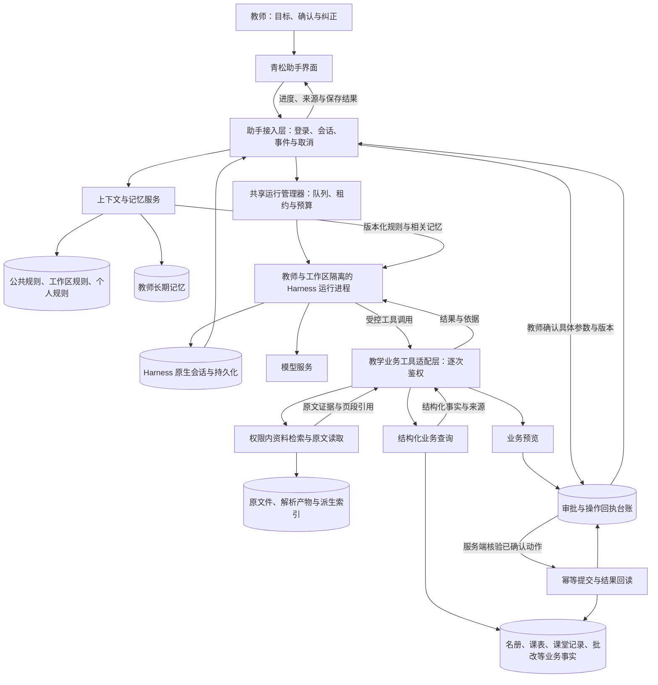

# 青松教学助手整体架构

版本：2.1 · 2026-10-27
状态：用户已认可整体方向并批准首批接入；Node统一及首批基础助手已发布，完整用户验收仍待用户。首批实现见ASSISTANT_BASELINE.md，生产事实见PROJECT_HANDOFF.md。五层规则/记忆、RAG、写入审批等未实现部分仍是后续架构，不能据首批批准擅自扩展。

## 1. 原始目标、范围与判断依据

目标是形成能理解教师工作、持续承接任务并受教师控制的教学助手：结合有权访问的资料和实时业务事实，完成查询、分析、备课、批改解释与经确认的业务操作。先设计完整系统，再按风险和依赖安排实现；不能把一个问答演示当作整体方案。

系统输入包括教师意图、当前页面对象、已确认规则与记忆、业务查询结果和资料证据。输出包括可追溯回答、可编辑成果、具体操作预览、保存回执和可恢复任务状态。教师控制目标、资料范围、记忆和关键写入；系统控制鉴权、工具执行边界、持久化与预算。模型负责理解、规划和生成，不能签发自己的权限或证明数据已保存。

外部不可控因素包括模型质量、网络、第三方服务、教师临时修改和设备/浏览器差异。控制回路为：提出目标→加载合法上下文→执行→观测结果→与目标比较→教师或系统纠偏→继续；局部工具失败隔离反馈，跨用户隔离失效等系统问题停止相关运行。

### 已确认事实

- 青松已有登录、个人工作区、课表/日程、名册、课堂记录、批改、资料与检索服务；助手仍是UI预留区。
- 当前`app_workspace_members`对user_id和workspace_id分别有唯一约束，实际为一位用户对应一个个人工作区。学校组织、多成员工作区和跨工作区共享授权尚未形成现成功能。
- 资料已有按关键词搜索和按资料全文检索；没有把它称作已具备向量混合召回/重排的完整RAG。
- 用户认可青松公共规则、工作区规则、教师个人规则、教师长期记忆、会话/任务状态五层；业务事实与资料原文仍有各自权威来源。
- 当前约束是少量受邀教师和现有单机服务。没有完成Harness进程内存、并发、调用成本与真实教材召回的测量。

本地代码依据与固定官方资料见[现状入口](../DEEPSEEK_HARNESS_READINESS.md)。本文中的组件名、状态、接口和数据对象均是拟定契约，不代表已有实现。

## 2. 系统边界与职责

推荐保留青松界面及业务服务，以官方SDK连接独立Harness运行进程；通过青松接入层绑定身份、编排上下文、适配业务工具与教师审批。复用框架的执行循环、原生会话/持久化和插件机制，不另写一套模型循环，也不直接把官方Web应用嵌进青松。

| 组件 | 负责 | 明确边界 |
| --- | --- | --- |
| 青松助手界面 | 对话、当前对象、资料范围、来源、任务进度、审批与记忆管理 | 页面选中对象是上下文，不是授权 |
| 助手接入层 | 登录鉴权、会话映射、事件转发、提交去重、取消和重连 | 浏览器不直接访问Harness、运行目录或模型密钥 |
| 上下文与记忆服务 | 规则版本、长期记忆生命周期、按需召回和失效过滤 | 不复制名册、成绩与原文形成第二份事实库 |
| 运行管理器 | 排队、进程租约、身份绑定、配额、超时、空闲回收和恢复 | 不代替Harness规划教学步骤 |
| Harness运行进程 | 官方模型/工具调度、会话记录、上下文压缩及已启用插件 | 仅获得允许的教学能力与当前身份凭证 |
| 教学业务工具适配层 | 类型校验、逐次鉴权、预览、幂等提交、确定性统计与回读 | 不给模型直接SQL、生产目录或通用Shell |
| 资料检索服务 | 解析产物复用、权限内检索、页段引用、版本和索引生命周期 | 检索返回内容作为证据，不升级成系统指令 |
| 业务与助手存储 | 分别保存教学事实、规则/记忆/审批、原生会话及事件投影 | 不宣称跨存储自动具有一个数据库事务 |

整体图见[harness.mmd](harness.mmd)。关键取舍见[ADR-001](adr/001-harness-integration.md)。



## 3. 五层规则、记忆与动态教学上下文

| 层级 | 内容与作用域 | 维护与装载 |
| --- | --- | --- |
| 1 青松公共规则 | 助手职责、教学表达、引用、操作确认、错误反馈 | 产品维护并版本化；必要行为始终装载，硬权限由服务端实现 |
| 2 工作区规则 | 工作区内的教学规范、共同模板和术语 | 当前仅个人工作区约定；学校管理者发布及共享继承为未来能力，需另建组织/权限模型 |
| 3 教师个人规则 | 教师明确提出的工作方法与输出约定，如先列教学目标 | 教师可查看/修改；默认按userId+workspaceId隔离，不能覆盖公共强制约束或工作区强制规范 |
| 4 教师长期记忆 | 已确认偏好、持续目标和跨会话有效的工作背景 | 结构化保存、按需召回、来源可查；模型推测先进入候选状态 |
| 5 会话/任务状态 | 讨论、计划、执行进度、待确认操作、当前成果和恢复位置 | 原生会话记录与业务执行台账协同；不自动升格为长期记忆 |

班级、学生、项目、课次和日期属于另一个维度的动态上下文。教师可以给指定教学项目设置有期限的目标，但它仍须绑定真实对象、来源与适用日期；不新增一层绕过权限的“学生永久画像记忆”。本班最近表现从业务记录查询，教材内容从资料库检索。

### 3.1 规则冲突与当前指令

硬边界先由服务端检查。软规则按任务相关性和适用范围组合：公共强制规则→工作区强制规范→教师个人默认规则→当前任务明确要求。允许覆盖的默认项可以被本次要求替代；冲突的强制项必须提示教师，不能无声选择。长期记忆是带来源的背景，不具有指令权限。

例：教师平时偏好简短，但本次要求详细分析，则本次详细回答；教师要求读取另一教师的资料，即使写进个人规则也不能授权。上传文件中的“忽略规则”只作为文件正文处理。

### 3.2 AGENTS.md的角色与加载

推荐以数据库中的版本化规则为权威，服务端将可用规则投影为Harness可读的`AGENTS.md`文件或有来源的上下文。生成文件可重建，教师不必维护服务器路径；运行进程不能自行修改公共规则或将投影反写成权威配置。

官方全局指令路径随进程的`DSH_HOME`、`DSH_AGENTS_HOME`解析；目录不能随登录用户在共享进程里切来切去。推荐每个userId+workspaceId运行命名空间使用独立的home与agents目录，只由运行管理器确定映射。详见[固定版本指令机制](https://github.com/deepseek-ai/deepseek-harness/blob/22ddee3792402c3e70ec5f86a63c3e3e895a2f60/packages/context/agent-instructions/README.md)。

五层产品语义不能机械等同于文件目录优先级。接入层先处理冲突和范围，再生成有效规则；不能依赖“更深的文件覆盖更浅的文件”维护平台约束。公共规则的完整源文保留在管理端，模型侧装载短的必要规则及任务相关细则；不得依赖可能被预算截断的长文件执行鉴权。

规则更新提交版本后，新请求装载新版本；正在进行的任务显示采用的规则版本。权限撤销立即阻止工具，不等待下个对话；会影响既有运行的硬规则变更需暂停并重新核验。原生指令刷新由文件触达/恢复等机制驱动，实施需验证显式刷新或重建上下文路径，不能假设外部改文件即时生效。

### 3.3 长期记忆生命周期

```text
教师明确“记住”或系统提出候选
  → 展示内容、范围、来源和有效期
  → 教师确认（原句即明确授权时直接保存并给回执）
  → 生效与按需召回
  → 修改 / 替代 / 到期 / 删除
```

建议记忆字段：memoryId、userId、workspaceId、类型、内容、关联对象、来源会话/消息/教师编辑、确认者、确认时间、version、status、有效期和敏感级别。候选置信度可以辅助排序，不能替代教师确认。状态为candidate、active、superseded、expired、deleted。

- 教师可搜索“记住了什么”、追溯来源、修改和删除；回答能说明使用了哪些相关记忆。
- 一次抱怨不推定为永久偏好；成绩、名单、学生健康和家庭信息不因聊天自动转成长期记忆。必要的业务事实走原有业务记录与权限。
- 冲突记忆不静默并存；保留版本，明确替代关系。删除/到期立即排除后续检索，相关缓存和摘要投影失效。
- 删除长期记忆与删除原对话是两个操作。界面说明区别；不能声称删除一条记忆就物理擦除原生日志或已有备份。
- “忘记此信息”须阻止从旧摘要再次晋升；使用删除标记及来源关联过滤。需要清除原对话时同步停止相关运行、禁止重放旧上下文，按单独的会话清除流程处理日志及附件，备份按明确保留策略处理。

### 3.4 装载顺序与预算

先装必要规则、身份派生的教学范围和当前任务；按问题选择相关规则/记忆；再通过工具取实时事实和资料片段；历史按需要读取或压缩。避免把全部记忆、学生档案和资料全文塞进每次请求。记忆召回数量、分块和重排参数后续通过样本校准；总上下文预算必须在调用前可检查，并记录来源与省略项。

## 4. 身份、运行实例与隔离

身份源为青松已验证登录态。服务端解析userId、workspaceId和role，建立sessionId/runId映射；客户端和模型都不能通过自报UID选数据。sessionId、runId只是索引，每次读取、订阅、取消、导出和工具执行都重新鉴权。

推荐执行上下文：principalRef、userId、workspaceId、membershipVersion、sessionId、runId、工具范围、可访问对象、timeZone及traceId。角色和成员有效性执行时重新读取；已入队任务不能靠旧上下文绕过撤权。

### 运行方式（推荐，待实现验证）

- 一个共享青松服务和运行管理器；按userId+workspaceId启动独立运行进程并持有独立home。进程可承接该教师多个会话，单个会话同一时刻仅一个写入运行。
- 进程按需启动、空闲回收，持久会话留存。不是每位教师部署整套青松，也不为每条消息安装一个Harness。
- 初始保守准入建议为每教师1个活动运行、全局1个活动运行，其他排队；这是现有单机尚未压测前的起点，不是容量结论。结合实际内存、延迟和成本后再调整，课堂手工操作不受助手队列阻塞。
- 独立目录和进程只是运行分区，不能当作操作系统安全隔离。运行进程不可挂载生产业务库或其他教师home；凭证只允许当前租约。容器/系统沙箱的目录、网络、子进程和资源限制须在实施前用越界测试验证。
- 不在共享进程中动态修改全局环境变量。模型凭据由宿主按运行注入，不进入提示词、工具参数、导出文件或浏览器。

### 撤权与转移

账号禁用或成员关系变化时，拒绝新请求、取消排队/活动运行、撤销内部凭证和流订阅。旧引用、摘要、附件链接也须重新检查；历史授权不代表当前授权。涉及失效资料的会话恢复必须先生成可访问的上下文投影；若原生历史无法安全过滤，则阻止直接恢复，开启经过过滤的新会话并展示原因。

现有个人工作区关系不改动，现有owner角色不能直接等同于学校管理员。未来教师转校、共同班级和学校共享库分别设计成员关系、资料授权及记忆携带规则，不能默默把旧工作区记忆带入新空间。

## 5. Harness组合、教学能力与工具接入

### 5.1 框架复用与默认能力核验

优先评估官方`sdk` profile及受控patch，保留所需会话、指令、压缩与Skills机制，移除不属于教学场景的默认能力。`sdk-minimal`是备选：默认已有Shell/目录等能力，同时省略工作区指令、Skills、jobs和subagents等服务，不能因名字“minimal”就认为开箱即满足教学助手。[官方组合说明](https://github.com/deepseek-ai/deepseek-harness/blob/22ddee3792402c3e70ec5f86a63c3e3e895a2f60/packages/bundle/sdk-minimal/README.md)

应用只通过官方启动/profile与SDK契约接入，不直接拼内部agent loop。框架已提供插件、工具管线和会话机制；青松实现业务适配与控制。[官方架构](https://github.com/deepseek-ai/deepseek-harness/blob/22ddee3792402c3e70ec5f86a63c3e3e895a2f60/docs/architecture.md)

允许列表以实际启动后的工具注册表为准，而非只检查配置里写了什么。未授权的Shell、通用文件读写、任意SQL、浏览器、插件安装及后台调度不可执行；供指令/Skills读取的文件提供者只服务受限目录，不等于向模型开放整个文件系统。

### 5.2 Skills、领域能力与专业Agent

Skills承载教学方法、输出契约及业务操作流程；工具访问实时数据并执行确定性操作。规则说明行为边界，记忆提供个体背景。三者分别版本化：教师偏好改变不必复制一套Skill，工具权限改变也不能靠改Skill完成。

| 领域能力 | 目标能力 | 接入边界 |
| --- | --- | --- |
| 教学安排 | 查课表/日程、安排提醒、查看教学进度 | 使用实际日期与时区；写入先预览 |
| 班级与课堂 | 查名册、课堂检查与表现，做确定性统计和趋势解释 | 统计来自完整业务范围，不把历史分页当总量 |
| 资料与备课 | 检索教材依据、生成教学建议和可编辑教案 | 教案现有入口仍是预览，真实生成/保存须补契约 |
| 批改与诊断 | 查询批改任务、解释证据和结果、形成讲评建议 | 人工终评、原图与既有批改流程保留；模型调用另计预算 |
| 教师个人工作 | 管理偏好、持续目标与任务成果 | 长期记忆、会话和已保存业务成果清晰区分 |

完整架构容纳后续专业Agent：主助手可委派备课、资料分析等受控子任务。子任务继承同一principalRef和预算，只获得必要对象/历史片段及工具子集；返回带证据的结果，不能自行扩大授权或绕过主任务审批。第一版不以多Agent并行作为前置条件，是否委派由任务复杂度、质量和成本评估，不按领域机械启动多个模型。

### 5.3 工具目录与调用契约

工具按领域注册、按任务和权限暴露。保存提醒只代表日程落库；定时触发、通知送达和后台Agent继续执行属于不同契约，持续调度在阶段E单独实现。以下名称仅示意：

| 类型 | 示例 | 关键输出 |
| --- | --- | --- |
| 只读业务 | list_classes、get_schedule、query_classroom_records、get_grading_task | 真实ID、查询时间/范围、版本、完整性或分页信息、可打开来源 |
| 资料 | search_materials、read_material_passage | 文件/版本/chunk/页段、证据正文、权限内来源链接 |
| 预览 | preview_reminder、preview_lesson_plan_save | 影响对象、前后差异、校验、版本、有效期、审批标识 |
| 提交/核对 | commit_approved_action、get_action_result | operationId、提交结果、结果版本与回读对象 |
| 记忆 | propose_memory、list_memories、update_memory、delete_memory | 来源、作用域、版本、确认状态 |

统一结果包含ok、code、data、sources、observedAt、version和completeness；失败带可理解的中文原因、是否保存和下一步。身份在执行通道附加，不让模型传任意workspaceId。参数和返回均有schema；业务工具不执行模型提供的代码、selector或任意路径。

### 5.4 SDK与MCP分工

SDK负责青松连接Harness的会话与运行；MCP可以负责Harness访问独立业务服务，两者不互斥。推荐先用薄业务插件经受控内部RPC调用青松业务层，减少新增网络面；跨客户端复用时再为同一工具契约加MCP适配，业务授权和提交逻辑只保留一份。

若选择MCP，使用绑定教师/工作区/运行、范围、过期与撤销的凭证，通过回环或私有通道连接，不公开生产MCP入口。官方支持stdio和Streamable HTTP，但传输能力不替代青松鉴权或写入审批。[官方MCP机制](https://github.com/deepseek-ai/deepseek-harness/blob/22ddee3792402c3e70ec5f86a63c3e3e895a2f60/packages/mcp/mcp-client/README.md)

此推荐取代v1.1中优先将“MCP服务”当成第一阶段固定形态的表述；保留MCP复用方向，先锁定业务契约。内部RPC的凭证载体与租约校验仍须在实现设计中固定并测试。

## 6. 知识与RAG

业务事实、原文件/解析产物、规则/记忆、原生会话、派生索引各有权威来源。资料RAG路径为：上传→解析/OCR→按结构切分→带权限与版本索引→权限内召回→必要时重排/补读→带页段引用回答。名册人数、检查次数、课表日期和成绩计算走结构化工具，不靠近似检索。

先复用已有分块、全文检索与阅读入口，再以真实中文教材、表格、扫描件评估是否增加向量与混合召回。索引记录resourceId、version、chunkId、页段、embedding版本和授权范围；更新增量构建，删除/撤权先立即拒读再清理派生索引。索引滞后时显示状态并可回退到合法原文，不给过期内容冒充新版本。

默认个人资料；教师可选指定文件或已获授权的共享范围。共享范围暂未实现时不提供可用假入口。跨文件检索既过滤标题/摘要又过滤正文；读取原文二次鉴权。引用区分业务事实、教师资料、教师记忆与模型建议，来源不足时明确指出缺口。

存储优先保留SQLite业务库，检索服务隔离其索引实现。向量模型、存储与重排器通过质量/成本样本决定，不把迁移PostgreSQL或部署独立memory产品作为前置条件。工具返回的引用不能只是一段无法打开的文本。

## 7. 写入审批与结果确认

每次写入遵循：形成候选→业务预览→教师确认具体版本和参数→服务端提交→回读结果→展示回执。候选教案可以继续编辑，但“草稿已生成”和“教案已保存”必须有不同状态。

审批记录建议包括approvalId、userId、workspaceId、runId、tool/动作类型、规范化参数哈希、目标对象、expectedVersion、previewId、expiresAt、status及确认者。审批一次使用；编辑参数、对象变化、预览过期或版本冲突即失效，重新预览。模型说“教师已同意”不构成审批。

以operationId保证提交幂等。已有课堂预览/版本/事件协议可复用，其他领域逐项补齐；不能假设所有现存API都有等价幂等。审批标记消费与业务变更应尽量在同一业务事务中完成；跨存储时使用业务侧幂等请求台账和可重放回执，不宣称分布式原子性。

若业务已提交但响应/会话日志丢失，先查询原operationId再补写回执，不重跑模型或重新生成写入编号。取消只是停止后续执行；已提交事实保留，支持撤销的业务走原撤销/补偿流程，不把停止生成等同于业务回滚。永久删除和批量影响需明确列出对象和不可恢复影响，不能用一条泛化“允许助手操作”覆盖。

## 8. 会话、事件与任务恢复

建议逻辑对象如下，物理表/文件名实施前再定：

| 对象 | 权威记录与用途 |
| --- | --- |
| AssistantSession | 归属、标题、原生session映射、当前规则版本、活动run；会话内容由原生日志持久化 |
| AssistantRun | principalRef、状态、租约、配置版本、预算、取消标记、原生运行映射与恢复原因 |
| RuleVersion / Memory | 规则、已确认记忆及生命周期，不能由导出的Markdown反向覆盖 |
| ActionApproval / ActionReceipt | 预览/确认/幂等操作及业务回执，提交结果以业务侧为准 |
| EventProjection | 原生事件游标及应用业务事件，服务端重连投影；不自造第二套原生聊天历史 |

拟定运行状态：queued→running→waiting_confirmation→running→succeeded；分支为cancel_requested→cancelled、failed、interrupted、recovery_required。输入接受、助手完成和业务保存使用不同反馈。succeeded要求本轮输出持久化且所有相关已提交操作有可核对回执，不能仅凭模型最后一句“完成”。

官方Session支持可重建事件记录，但持久化需实际挂载相应后端；压缩不是删除原始历史。[官方Session机制](https://github.com/deepseek-ai/deepseek-harness/blob/22ddee3792402c3e70ec5f86a63c3e3e895a2f60/packages/core/session/README.md) 青松复用原生日志并保存映射、审批和恢复台账；跨存储失败时以业务回执纠偏。

- 浏览器断线不直接取消运行；重连通过会话与事件游标补取已持久化结果，暂态流片段可能需要用最终消息替换。
- 同一会话多标签发送以clientMessageId去重，并以会话版本/租约串行处理；过期窗口不能并发启动第二次写入运行。
- 进程重启后扫描过期租约：只读任务显示中断并允许继续；待审批任务重新校验预览有效性；写入结果未知先核对回执。不能无条件重放工具。
- 取消触发流和工具取消信号，但第三方可能已经执行；取消结果未知仍进入recovery_required，而非宣称“没有保存”。
- 持久化失败停止后续副作用；恢复重放不得把一次模型调用或一次提交变成两次。原生flush/shutdown和业务事务分别有验证点。

## 9. 界面与教师控制

桌面复用工作台右侧贯穿高度的助手区域，消息区域内部滚动，输入与停止操作保持可达。手机进入完整会话工作面，消息、输入、来源与审批按主任务组织，支持软键盘、窄屏和低高度；继续复用DESIGN.md共享控件，不改光学参数或整体导航。

界面至少包含：会话列表/恢复、当前班级/课次与资料范围、工具进度、部分失败、可打开来源、可编辑成果、操作审批卡、提交回执、取消以及规则/记忆管理。来源打开后返回保留会话位置；不会因为切换页面自动扩大工具可写范围。

教师能回答“它现在在做什么、用了什么依据、记住了什么、改了什么、哪里没完成、我如何停止/纠正”。从当前页面发起可建议上下文，但跨班或批量影响时必须显示实际对象。原有手工入口始终可用；助手异常不阻断点名、名册或课表操作。教师纠正先作用于本次任务；是否保存为个人规则或长期记忆另行明确。质量反馈用于样本评估和版本修订，不自动跨教师合并个人记忆。

## 10. 运行治理、故障隔离与上线

| 项目 | 推荐控制 |
| --- | --- |
| 版本 | 固定Harness发布版本/提交、SDK、Node、profile与教学插件版本；记录到每次run |
| 资源 | 教师/全局排队、进程CPU/内存限制、空闲回收；先测量再调整并发 |
| 成本 | 分别记录主模型、压缩、embedding、OCR、子任务用量；调用/重试/费用预算集中核算，重试不能绕预算 |
| 超时 | 模型、工具和整轮分别设置上限；只在允许重试的类别重试，写入先核对结果 |
| 凭据 | 宿主管理、按用途注入、到期撤销；内部日志不记录原始凭据与无关学生全文 |
| 观测 | session/run/operation/trace串联，暴露阶段、错误类别、耗时、用量、审批与结果，不把日志当教师唯一反馈 |
| 保留与删除 | 会话、附件、候选/长期记忆和审计分别制定期限；明确删除、撤权、导出和备份边界 |
| 更新 | 新版本用独立运行目录与隔离样本验证；持久会话格式不兼容时禁止盲目恢复 |

本次官方根package.json声明版本0.2.1-rc.3及Node>=24.9.0，仅作为本轮研究基线，不等于已选定安装版本。[版本依据](https://github.com/deepseek-ai/deepseek-harness/blob/22ddee3792402c3e70ec5f86a63c3e3e895a2f60/package.json) 现有生产运维记录为Node22基线，实施前重新核对；用户随后批准将青松、DSH与备份统一到Node24 LTS；目标固定24.22.1，在新发布目录重装原生依赖、验证后同步切换，旧Node22仅作为原发布的恢复选项保留。

教师资料/RAG失败是局部故障：说明缺少哪些依据并允许其他合法任务继续。权限异常、运行身份混用或审批校验缺失属于系统性问题，停止相关执行并告警。模型不可用时保留输入与已生成成果，手工业务入口继续使用。

首轮需在调用前明确预算、超时和日志期限；未配置必需预算时不准入，不以“无限制默认值”上线。容量与费用目标由样本测量后确定，不把框架成熟度当作当前2GB服务器承载结论。

## 11. 分阶段实施与验收

下面是完整架构的落地顺序，不缩小最终产品能力。每阶段另行提交实现范围与授权，文档批准不自动批准执行。

| 阶段 | 交付与退出条件 |
| --- | --- |
| A 契约与运行验证 | 固定版本/profile/Node、工具注册表、目录与网络隔离；验证SDK启停、流、持久化和规则装载；两教师隔离样本通过，再确定预算/容量参数 |
| B 个体化助手基础 | 五层作用域、个人规则/记忆管理、会话列表与恢复、来源、停止、只读教学工具和资料检索贯通；多标签、撤权、删除记忆/资料与跨会话测试通过 |
| C 受控业务写入 | 审批/幂等/回读协议、一个普通写入和一个真实教学成果保存贯通；修改参数、版本冲突、丢响应、刷新/重启后结果未知均能核对 |
| D 领域能力完善 | 扩展教案、批改解释、诊断、跨工具任务与有依据的专业Agent；领域正确性、成本和人工接管逐项验收 |
| E 组织与持续任务 | 在组织/共享权限模型明确后接共享规则/资料、长期调度与协作；不能用现有个人工作区冒充学校多人产品 |

验收矩阵至少覆盖：两教师同名班级/文件不串数据；按权限订阅历史与导出；统计完整准确；引用定位正确版本/页段；规则覆盖符合约定；无确认不晋升记忆；记忆删除不被旧摘要复活；撤权后工具与历史均拒读；未确认写入为0；重复确认/丢响应/重启最终仅一次业务变更；取消不隐去已提交事实；长对话压缩后仍守规则；手机软键盘/滚动/审批可达。

每次验收分别报告准确性、失败恢复、成本、首反馈与完成延迟、教师能否理解并纠正。不能只用一句“测试通过”或模型演示代替真实样本。正式模型调用、生产数据读取、迁移与部署均需对应明确授权。

## 12. 决策状态与待决事项

已认可：整体优先、五层规则/记忆结构、复用DeepSeek Harness。

本稿推荐：保留青松界面和鉴权；SDK+受控profile；共享运行管理器和按教师/工作区隔离的运行命名空间；规则/记忆数据库权威与Markdown投影；先业务契约后可选MCP；复用原生会话而非再造执行循环。

实施前必须固定：安装版本与SDK事件契约、profile允许列表与指令/Skill挂载、OS隔离方案、内部凭证协议、会话/回执跨存储恢复契约、模型/向量评估样本、预算/超时/保留期限和可测验收阈值。这些是具体实施设计的输入，不在本轮假定为已实现。

## 修改历史

- 2.0 / 2026-10-26：从v1.1准备度说明升级为整体架构；增加五层规则/记忆、身份与运行隔离、领域能力、审批回读、恢复与治理；调整SDK/MCP推荐，补固定官方基线及本地事实边界。仅文档。

- 2.1（2026-10-27）：标明整体方向与首批授权，链接真实实现及生产事实入口；完整五层能力仍按阶段验收。
